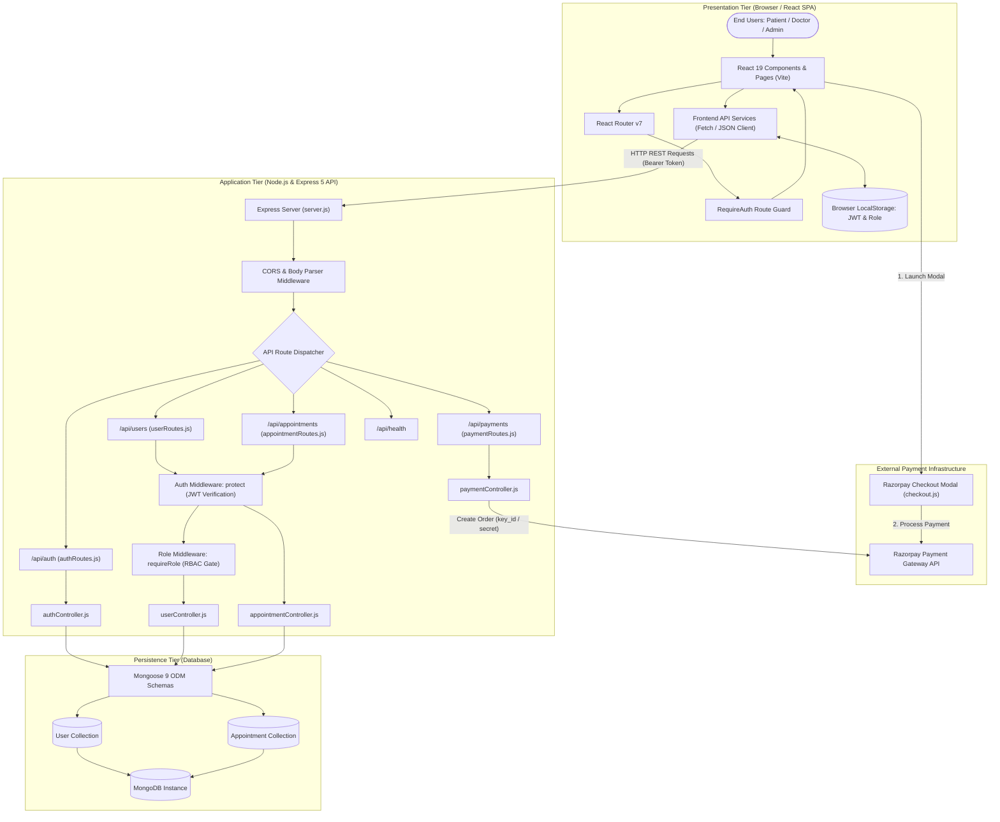
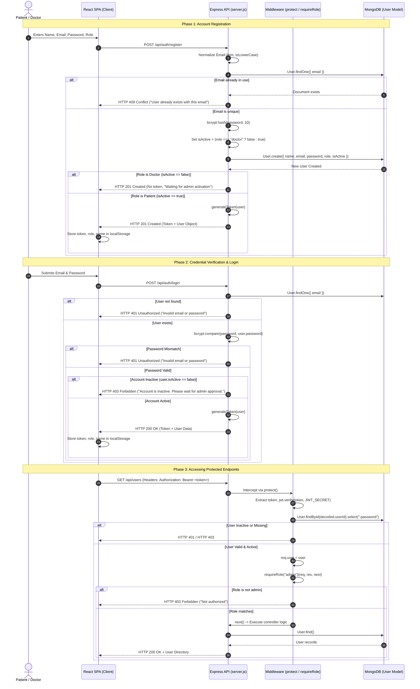
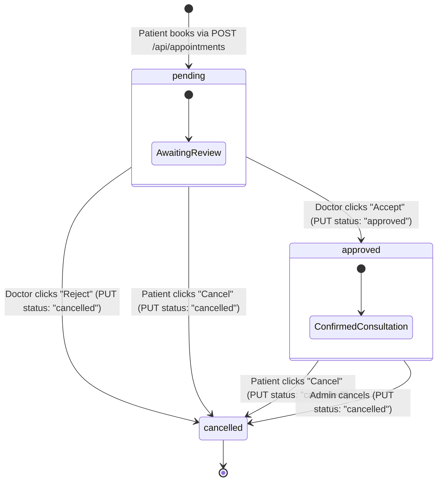
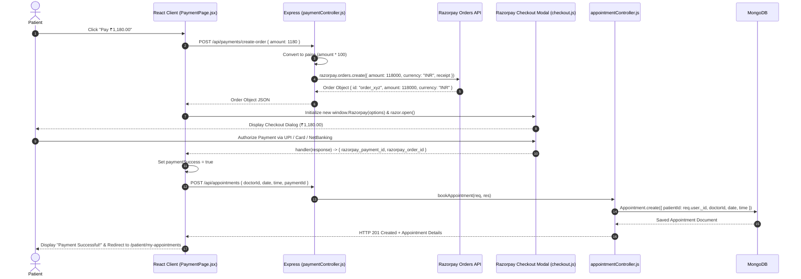
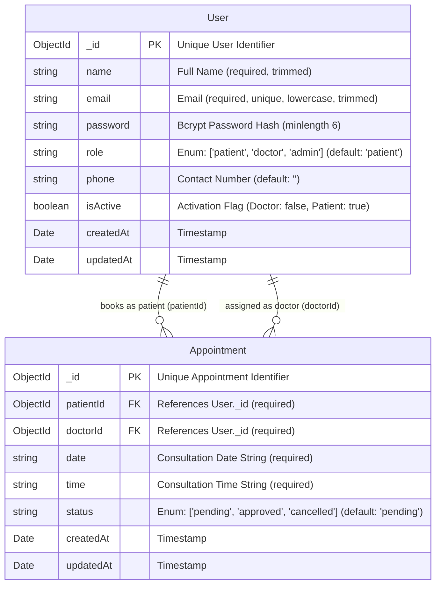
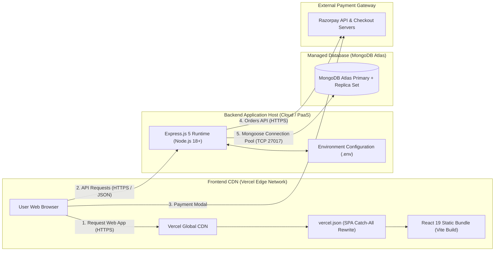
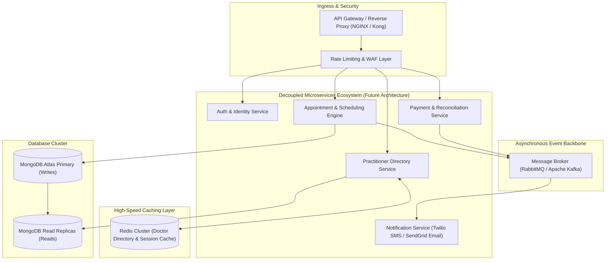

# MediConnect - High-Level Design (HLD)

---

## 1. Document Information

| Attribute | Details |
| :--- | :--- |
| **Project Name** | MediConnect |
| **Document Name** | High-Level Design (HLD) Document |
| **Version** | 1.0.0 |
| **Document Status** | Approved / Initial Architecture Documentation |
| **Date of Preparation** | November 4, 2026 |
| **System Category** | Outpatient Doctor Consultation & Appointment Scheduling System |
| **Repository URL** | [https://github.com/dkhemka12/MediConnect](https://github.com/dkhemka12/MediConnect) |
| **Live Web App** | [https://medi-connect-henna.vercel.app/](https://medi-connect-henna.vercel.app/) |
| **Target Audience** | Software Architects, Engineering Leads, Security Auditors, Academic Evaluators |

### Revision History

| Version | Date | Author / Role | Summary of Changes |
| :--- | :--- | :--- | :--- |
| `1.0.0` | 2026-11-04 | Senior Software Architect | Initial comprehensive High-Level Design baseline derived from exhaustive codebase inspection across frontend, backend, database, and integration boundaries. |

---

## Table of Contents

- [1. Document Information](#1-document-information)
- [2. Introduction](#2-introduction)
  - [2.1 Purpose of the Document](#21-purpose-of-the-document)
  - [2.2 Architectural Scope](#22-architectural-scope)
  - [2.3 Design Principles](#23-design-principles)
- [3. System Overview](#3-system-overview)
  - [3.1 Platform Context](#31-platform-context)
  - [3.2 User Roles & Operational Boundaries](#32-user-roles--operational-boundaries)
- [4. Technology Stack](#4-technology-stack)
- [5. Overall System Architecture](#5-overall-system-architecture)
  - [5.1 Multi-Tier Architectural Topology](#51-multi-tier-architectural-topology)
  - [5.2 Communication Protocols & Boundaries](#52-communication-protocols--boundaries)
- [6. Component Architecture](#6-component-architecture)
  - [6.1 Frontend Tier (Client Architecture)](#61-frontend-tier-client-architecture)
  - [6.2 Backend Tier (Server Architecture)](#62-backend-tier-server-architecture)
  - [6.3 Data & Integration Layer Architecture](#63-data--integration-layer-architecture)
- [7. User Role Architecture & Access Control Matrix](#7-user-role-architecture--access-control-matrix)
- [8. Authentication and Authorisation Architecture](#8-authentication-and-authorisation-architecture)
  - [8.1 Cryptographic Identity & Session Lifecycle](#81-cryptographic-identity--session-lifecycle)
  - [8.2 End-to-End Authentication Sequence](#82-end-to-end-authentication-sequence)
  - [8.3 Token Mechanics & Claims](#83-token-mechanics--claims)
- [9. Appointment Management Architecture](#9-appointment-management-architecture)
  - [9.1 Booking Orchestration](#91-booking-orchestration)
  - [9.2 Role-Scoped Appointment Retrieval](#92-role-scoped-appointment-retrieval)
  - [9.3 Appointment Status Lifecycle & Decision Engine](#93-appointment-status-lifecycle--decision-engine)
  - [9.4 Status Update & Ownership Verification Sequence](#94-status-update--ownership-verification-sequence)
- [10. Payment Architecture](#10-payment-architecture)
  - [10.1 Order Creation & Checkout Flow](#101-order-creation--checkout-flow)
  - [10.2 Payment Integration Workflow](#102-payment-integration-workflow)
  - [10.3 Architecture Reality Check: Payment Verification Gaps](#103-architecture-reality-check-payment-verification-gaps)
- [11. Database Architecture](#11-database-architecture)
  - [11.1 Entity-Relationship Model](#111-entity-relationship-model)
  - [11.2 Schema Design & Attribute Specifications](#112-schema-design--attribute-specifications)
- [12. API Architecture](#12-api-architecture)
  - [12.1 Authentication Subsystem APIs](#121-authentication-subsystem-apis)
  - [12.2 User Management Subsystem APIs](#122-user-management-subsystem-apis)
  - [12.3 Appointment Subsystem APIs](#123-appointment-subsystem-apis)
  - [12.4 Payment Subsystem APIs](#124-payment-subsystem-apis)
  - [12.5 System Health API](#125-system-health-api)
- [13. Deployment Architecture](#13-deployment-architecture)
  - [13.1 Production Topology (Observed Configuration)](#131-production-topology-observed-configuration)
  - [13.2 Environment Variable Configurations](#132-environment-variable-configurations)
  - [13.3 Recommended Future Enterprise Topology](#133-recommended-future-enterprise-topology)
- [14. Security Architecture](#14-security-architecture)
  - [14.1 Threat Model & Protection Realization](#141-threat-model--protection-realization)
  - [14.2 Vulnerabilities & Architectural Debt](#142-vulnerabilities--architectural-debt)
- [15. Error Handling and Reliability](#15-error-handling-and-reliability)
  - [15.1 Response Envelope Structure](#151-response-envelope-structure)
  - [15.2 Failure Modes & Resilience Measures](#152-failure-modes--resilience-measures)
- [16. Scalability and Future Architecture](#16-scalability-and-future-architecture)
- [17. Architectural Limitations and Technical Risks](#17-architectural-limitations-and-technical-risks)
- [18. Glossary & Domain Terminology](#18-glossary--domain-terminology)

---

## 2. Introduction

### 2.1 Purpose of the Document
This High-Level Design (HLD) document defines the architectural blueprint of the **MediConnect** outpatient consultation platform. It articulates the structural, behavioral, security, and integration designs of the system as implemented in the codebase. The document serves as the technical benchmark for software engineers, systems architects, security reviewers, and evaluators to understand the component hierarchies, state machines, and communication interfaces.

### 2.2 Architectural Scope
The scope of this document encompasses:
- The Single Page Application (SPA) presentation tier engineered in React 19 and bundled via Vite.
- The stateless API application gateway and controller tier developed with Node.js and Express 5.
- The persistence tier leveraging MongoDB and Mongoose 9 schemas.
- The external transaction interface powered by Razorpay.
- The identity lifecycle, role-based authorization gates, and operational data flows.

> [!IMPORTANT]
> This document details the **currently implemented system architecture**. Aspirational features (such as automated SMS gateways, video conferencing servers, or dynamic calendar schedulers) are explicitly categorized under future architectural roadmaps and are not presented as active components.

### 2.3 Design Principles
The architecture conforms to five foundational software engineering principles:
1. **Separation of Concerns (SoC):** Distinct separation between user interface rendering, HTTP transport routing, business domain enforcement, and database querying.
2. **Stateless Service Layer:** Express application nodes maintain zero session memory, relying on cryptographically signed JSON Web Tokens (JWT) for authentication.
3. **Defense-in-Depth Authorization:** Role access is asserted at the controller/middleware layer independently of frontend view visibility.
4. **Normalized RESTful Interfaces:** Predictable HTTP verb semantics (`GET`, `POST`, `PUT`) mapped to resource collections.
5. **Decoupled Persistence Modeling:** Declarative Mongoose schemas enforcing model validation, default states, and relational foreign-key references (`ref: "User"`).

---

## 3. System Overview

### 3.1 Platform Context
MediConnect provides an integrated, digital outpatient appointment management platform designed to eliminate the logistical friction of telephone-based appointments, uncoordinated physical clinic queues, and unverified medical credentials.

The platform unifies three primary stakeholders into a synchronized operational pipeline:
```
   [ Patient ]              [ Doctor ]              [ Administrator ]
        │                        │                          │
        ▼                        ▼                          ▼
Browse & Book Outpatient   Review Clinical Queue      Verify Practitioner
Consultations & Pay Fees   & Accept/Reject Bookings   Credentials & Platform Users
```

### 3.2 User Roles & Operational Boundaries
The system enforces strict boundary definitions for three distinct user roles:

1. **Patient (`patient`):**
   - The healthcare consumer.
   - Self-registers and immediately receives active platform status (`isActive: true`).
   - Discovers credentialed, active practitioners via a searchable public directory.
   - Configures appointment date/time slots and executes payment via an integrated Razorpay checkout modal.
   - Monitors booking statuses (`pending`, `approved`, `cancelled`) and retains unilateral self-cancellation authority.

2. **Doctor (`doctor`):**
   - The clinical service provider.
   - Self-registers with role `doctor`, but is initialized in a **dormant, inactive state (`isActive: false`)**.
   - Cannot authenticate or receive patient bookings until authorized by a platform administrator.
   - Manages assigned consultation queues, reviews clinical requests, and executes binary acceptance (`approved`) or rejection (`cancelled`) decisions.

3. **Administrator (`admin`):**
   - The platform governance authority.
   - Accesses an administrative command view to monitor user registrations.
   - Evaluates doctor registrations and toggles their operational status (`isActive: true / false`), unlocking or revoking practitioner login and directory visibility.
   - Retains system-wide read and mutation access across all platform appointments and user accounts.

---

## 4. Technology Stack

The following technology stack represents the verified dependencies and runtimes extracted directly from the root, client, and server configuration files:

| Layer / Concern | Technology | Package / Version | Architectural Role |
| :--- | :--- | :--- | :--- |
| **Frontend Framework** | React | `^19.2.4` | Declarative component UI rendering and reactive state management |
| **Frontend Build Tool** | Vite | `^8.0.4` | Development bundler with Hot Module Replacement (HMR) and optimized rollup production assets |
| **Client-Side Routing** | React Router DOM | `^7.14.1` | Declarative routing, browser history management, and navigation state transport |
| **Frontend Styling** | Custom CSS3 | Native CSS Modules | Responsive layout using CSS Grid, Flexbox, and CSS custom variables |
| **Backend Runtime** | Node.js | `>= 18.x` | Asynchronous, event-driven server-side JavaScript execution environment |
| **Web Application Server** | Express.js | `^5.2.1` | HTTP API application framework, middleware pipeline, and route dispatching |
| **Database Engine** | MongoDB | Cloud / Local | Document-oriented NoSQL database providing JSON-like BSON persistence |
| **Object Data Modeling (ODM)** | Mongoose | `^9.5.0` | Schema definition, model validation, query middleware, and reference population |
| **Password Cryptography** | bcryptjs | `^3.0.3` | One-way adaptive hashing with salt rounds for user credential persistence |
| **Token Cryptography** | jsonwebtoken | `^9.0.3` | HMAC-SHA256 signing and verification of stateless Bearer authentication tokens |
| **Cross-Origin Security** | cors | `^2.8.6` | Configurable whitelist middleware for Cross-Origin Resource Sharing |
| **Environment Configuration** | dotenv | `^17.4.2` | Runtime loading of environment variables from `.env` files |
| **Process Supervision** | nodemon | `^3.1.14` | Backend file-watcher for development auto-restart (`devDependencies`) |
| **Payment Gateway SDK** | Razorpay Node SDK | `^2.9.6` | Server-to-server Razorpay Orders API client |
| **Payment Client Checkout** | Razorpay Checkout | Hosted script (`v1`) | Dynamic client-side payment modal loaded in `index.html` |
| **Development Concurrency** | concurrently | `^9.2.1` | Simultaneous execution of client and server dev instances from root |
| **Frontend Deployment** | Vercel | `vercel.json` | Global Edge Network hosting with client-side SPA route rewrites |

---

## 5. Overall System Architecture

### 5.1 Multi-Tier Architectural Topology

The MediConnect system follows a decoupled, three-tier architectural topology:
1. **Presentation Tier (Client):** React 19 Single Page Application running in the user's browser.
2. **Application & Business Logic Tier (Server):** Node.js/Express REST API processing incoming HTTP requests, enforcing RBAC, and orchestrating domain workflows.
3. **Data Persistence Tier (Database):** MongoDB database accessed via Mongoose ODM.
4. **Third-Party Services Tier:** Razorpay payment infrastructure interacting with both client and server.



### 5.2 Communication Protocols & Boundaries

```
[ Client Tier ] ──( HTTPS / JSON / Bearer JWT )──> [ Express Application Tier ]
       │                                                      │
       │                                                      │ (Mongoose TCP Driver)
       │ (Razorpay JS SDK)                                    ▼
       ▼                                            [ MongoDB Persistence Tier ]
[ Razorpay Gateway ] <──────( HTTPS REST )───────────┘
```

- **Client-to-Server:** Stateless HTTP/1.1 or HTTP/2 transport. Payloads are formatted as `application/json`. Authenticated endpoints require the standard header `Authorization: Bearer <token>`.
- **Server-to-Database:** Persistent TCP connection pool managed by Mongoose using the connection string defined in `MONGO_URI`.
- **Server-to-Razorpay:** HTTPS REST API communication using the official `razorpay` NPM package initialized with `RAZORPAY_KEY_ID` and `RAZORPAY_KEY_SECRET`.

---

## 6. Component Architecture

### 6.1 Frontend Tier (Client Architecture)

The frontend is organized inside `client/src/` into logical sub-architectures:

```
client/src/
├── components/          # Reusable UI widgets and layout shells
│   ├── Navbar.jsx       # Dynamic top navigation; switches links based on auth and role
│   ├── Footer.jsx       # Global application footer
│   ├── DoctorCard.jsx   # Practitioner display card with avatar fallback and actions
│   └── RequireAuth.jsx  # Route guard redirecting unauthenticated requests to /login
├── pages/               # Page controllers mapped to React Router routes
│   ├── Home.jsx         # Public landing page with hero CTA
│   ├── auth/            # Authentication flows (Login.jsx, Register.jsx)
│   ├── patient/         # Outpatient portal views (Dashboard, Doctors, DoctorDetails, 
│   │                    # BookAppointment, PaymentPage, MyAppointments, About)
│   ├── doctor/          # Clinical portal views (Dashboard, Appointments)
│   └── admin/           # Governance portal views (Dashboard, Users)
└── services/            # Data-access abstraction layer
    ├── api.js           # Generic fetch wrapper injecting Bearer token headers
    ├── auth.js          # LocalStorage session reader/writer/clearer
    ├── authService.js   # API endpoints for /api/auth
    ├── appointmentService.js # API endpoints for /api/appointments
    └── userService.js   # API endpoints for /api/users
```

#### Key Client Component Roles:
- **`RequireAuth.jsx`:** Intercepts route rendering. Executes `isAuthenticated()` check against `localStorage.getItem("token")`. If missing, aborts rendering and dispatches `<Navigate to="/login" replace state={{ from: location.pathname }} />`.
- **`Navbar.jsx`:** Listens to `isAuthenticated()` and `getUserRole()`. Dynamically switches the primary CTA between `"Home"` and the role-specific dashboard (`/patient/dashboard`, `/doctor/dashboard`, or `/admin/dashboard`), and toggles between `"Login"/"Get Started"` and `"Logout"`.
- **`PaymentPage.jsx`:** Acts as the checkout orchestration controller. Receives doctor ID, date, and time via React Router navigation state, calls the backend to create a Razorpay order, binds the Razorpay modal, and on payment completion calls `createAppointment()`.

---

### 6.2 Backend Tier (Server Architecture)

The backend is structured under `server/` according to standard Model-View-Controller (MVC) separation of concerns:

```
server/
├── config/
│   └── db.js            # Mongoose connection manager with process termination on failure
├── controllers/         # Business logic execution & domain enforcement
│   ├── authController.js        # User registration, bcrypt hashing, login, JWT issuance
│   ├── userController.js        # Directory retrieval & admin activation toggles
│   ├── appointmentController.js # Booking creation, scoped retrieval, status normalization
│   └── paymentController.js     # Razorpay Orders API order generator
├── middleware/
│   └── authMiddleware.js        # protect (JWT verification) & requireRole (RBAC gate)
├── models/
│   ├── User.js          # Mongoose schema for user accounts & activation states
│   └── Appointment.js   # Mongoose schema for consultation bookings
├── routes/              # HTTP verb & endpoint route binding
│   ├── authRoutes.js
│   ├── userRoutes.js
│   ├── appointmentRoutes.js
│   └── paymentRoutes.js
├── utils/
│   └── generateToken.js # JWT signing helper utilizing process.env.JWT_SECRET
└── server.js            # Express application bootstrapper, CORS setup, and route mounting
```

---

### 6.3 Data & Integration Layer Architecture

- **`config/db.js`:** Encapsulates the MongoDB connection logic using `mongoose.connect(process.env.MONGO_URI)`. If the connection promise fails, it logs the error to `stderr` and executes `process.exit(1)`, enforcing a crash-fast policy to prevent unpersisted API operation.
- **`models/`:** Enforces schema constraints directly on the database driver level:
  - `User.js` enforces field trim, lowercase email normalization, password minimum length (6), and role enumeration (`patient`, `doctor`, `admin`).
  - `Appointment.js` enforces foreign key reference binding (`ref: "User"`) for both `patientId` and `doctorId`.

---

## 7. User Role Architecture & Access Control Matrix

MediConnect implements **Role-Based Access Control (RBAC)** enforced at the Express route middleware layer. The access control matrix below illustrates the precise rights of each persona across the actual system endpoints:

| Feature / Action | API Endpoint & Verb | Public | Patient | Doctor | Admin | Backend Security Enforcement |
| :--- | :--- | :---: | :---: | :---: | :---: | :--- |
| **Register Account** | `POST /api/auth/register` | ✅ | ✅ | ✅ | ⚠️ | Open to public; accepts role in body (`patient` or `doctor`). |
| **Authenticate / Login** | `POST /api/auth/login` | ✅ | ✅ | ✅ | ✅ | Checks password hash and verifies `isActive === true`. |
| **Browse Active Doctors** | `GET /api/users/doctors` | ✅ | ✅ | ✅ | ✅ | Publicly readable; filtered at DB level for `{ role: 'doctor', isActive: true }`. |
| **System Health Check** | `GET /api/health` | ✅ | ✅ | ✅ | ✅ | Publicly readable. |
| **Book Appointment** | `POST /api/appointments` | ❌ | ✅ | ❌* | ❌* | Guarded by `protect`. Forces `patientId = req.user._id`. |
| **Create Razorpay Order** | `POST /api/payments/create-order` | ✅* | ✅ | ✅ | ✅ | Currently unprotected route; accepts `{ amount }`. |
| **View Appointments** | `GET /api/appointments` | ❌ | ✅ | ✅ | ✅ | Guarded by `protect`. Scopes results by `patientId`, `doctorId`, or all for `admin`. |
| **Cancel Appointment** | `PUT /api/appointments/:id` | ❌ | ✅ | ✅ | ✅ | Patient can only set `cancelled` on owned bookings; Doctor can set `cancelled`. |
| **Approve Appointment** | `PUT /api/appointments/:id` | ❌ | ❌ | ✅ | ✅ | Doctor can set `approved` on assigned bookings; Admin can override. |
| **View All Users** | `GET /api/users` | ❌ | ❌ | ❌ | ✅ | Guarded by `protect` + `requireRole("admin")`. |
| **Toggle User Activation**| `PUT /api/users/:id/activation` | ❌ | ❌ | ❌ | ✅ | Guarded by `protect` + `requireRole("admin")`. |

*\*Note on Implementation Details:*
- While a doctor or admin *could* technically send a request to `POST /api/appointments`, the backend uses `req.user._id` as the `patientId`, treating the caller as a patient.
- `POST /api/payments/create-order` does not currently invoke `protect`, meaning it is accessible without an Authorization header.

---

## 8. Authentication and Authorisation Architecture

### 8.1 Cryptographic Identity & Session Lifecycle

The authentication subsystem is completely stateless, relying on JSON Web Tokens and one-way bcrypt hashing:

```
[ User Password ] ──( bcrypt.hash, salt rounds = 10 )──> [ 60-char Hash Stored in DB ]
```

When a user logs in, `bcrypt.compare()` evaluates the incoming plaintext password against the stored hash. Upon verification, `generateToken()` creates a signed token:
```
Header:    { "alg": "HS256", "typ": "JWT" }
Payload:   { "userId": "<User._id>", "role": "<User.role>", "iat": ..., "exp": ... }
Signature: HMAC-SHA256(Header + "." + Payload, process.env.JWT_SECRET)
```

---

### 8.2 End-to-End Authentication Sequence

The sequence diagram below models the complete registration, activation, authentication, and token verification pipeline:



### 8.3 Token Mechanics & Claims
- **Signature Algorithm:** `HS256` (HMAC with SHA-256).
- **Secret Key:** `process.env.JWT_SECRET`.
- **Expiration Interval:** Defaults to `7d` or configured via `process.env.JWT_EXPIRES_IN`.
- **Payload Schema:**
  ```json
  {
    "userId": "6724a1b2c3d4e5f678901234",
    "role": "doctor",
    "iat": 1730718000,
    "exp": 1731322800
  }
  ```

---

## 9. Appointment Management Architecture

### 9.1 Booking Orchestration
Appointments are created via `POST /api/appointments`. The request is secured by the `protect` middleware, which injects `req.user`.

```
Incoming Request:  { doctorId, date, time }
Injected Context:  patientId = req.user._id
Default State:     status = "pending"
```

The controller does not accept client-specified appointment statuses or patient IDs, guaranteeing that malicious clients cannot forge bookings on behalf of other accounts.

---

### 9.2 Role-Scoped Appointment Retrieval
When a user queries `GET /api/appointments`, the backend dynamically constructs a database query scoped strictly by caller role:

```javascript
let query = {};
if (req.user.role === "patient") {
  query.patientId = req.user._id;  // Patient sees ONLY their bookings
} else if (req.user.role === "doctor") {
  query.doctorId = req.user._id;   // Doctor sees ONLY assigned bookings
}
// If req.user.role === "admin", query remains {}, returning all system appointments.
```

The query automatically calls `.populate("patientId", "name email phone")` and `.populate("doctorId", "name email phone")` to return hydrated user profiles while excluding password hashes.

---

### 9.3 Appointment Status Lifecycle & Decision Engine

The appointment state machine enforces strict role-based state transitions:



#### Status Normalization Rules (`normalizeStatus`):
- Inputs `"approved"` or `"confirmed"` $\rightarrow$ Normalized to `"approved"`.
- Inputs `"cancelled"` or `"canceled"` $\rightarrow$ Normalized to `"cancelled"`.
- Input `"pending"` $\rightarrow$ Normalized to `"pending"`.
- Any other string $\rightarrow$ Rejected with HTTP 400 (`"Valid status is required"`).

---

### 9.4 Status Update & Ownership Verification Sequence

The sequence diagram below illustrates how `PUT /api/appointments/:id` enforces record ownership and status-transition authorization:

```mermaid
sequenceDiagram
    autonumber
    actor Caller as Doctor / Patient
    participant Client as React Client
    participant API as Express Router
    participant AuthMW as protect Middleware
    participant AptCtrl as appointmentController.js
    participant DB as MongoDB (Appointment)

    Caller->>Client: Click Action (Accept / Reject / Cancel)
    Client->>API: PUT /api/appointments/:id { status: "approved" | "cancelled" }
    API->>AuthMW: Verify Bearer JWT
    AuthMW->>AptCtrl: req.user attached
    AptCtrl->>AptCtrl: normalizeStatus(status)
    AptCtrl->>DB: Appointment.findById(id)
    alt Record Not Found
        DB-->>AptCtrl: null
        AptCtrl-->>Client: HTTP 404 Not Found ("Appointment not found")
    else Record Exists
        DB-->>AptCtrl: appointment document
        
        %% Ownership Validation Checks
        AptCtrl->>AptCtrl: Evaluate Caller Identity vs Ownership
        alt Caller is Doctor BUT appointment.doctorId != req.user._id
            AptCtrl-->>Client: HTTP 403 Forbidden ("Not authorized to update this appointment")
        else Caller is Patient BUT appointment.patientId != req.user._id
            AptCtrl-->>Client: HTTP 403 Forbidden ("Not authorized to update this appointment")
        else Ownership Verified
            %% Role Action Restrictions
            alt Caller is Doctor AND status is NOT "approved" or "cancelled"
                AptCtrl-->>Client: HTTP 400 Bad Request ("Doctors can only accept or reject appointments")
            else Caller is Patient AND status != "cancelled"
                AptCtrl-->>Client: HTTP 400 Bad Request ("Patients can only cancel appointments")
            else Valid Mutation
                AptCtrl->>DB: appointment.status = normalizedStatus; appointment.save()
                DB-->>AptCtrl: Saved document
                AptCtrl-->>Client: HTTP 200 OK + Updated Appointment Data
            end
        end
    end
```

---

## 10. Payment Architecture

### 10.1 Order Creation & Checkout Flow

MediConnect integrates the **Razorpay Payment Gateway** to facilitate consultation fee settlement. The interaction spans three parties: the patient's browser, the Express backend, and the Razorpay cloud infrastructure.

```
+---------------------------------------------------------------------------------------+
|                             ORDER & CHECKOUT ARCHITECTURE                             |
+---------------------------------------------------------------------------------------+
|  1. Patient selects appointment date/time on /patient/book-appointment/:id.           |
|  2. Navigation state transfers { selectedDate, selectedTime } to /patient/payment/:id.|
|  3. Frontend requests order creation: POST /api/payments/create-order { amount: 1180 }|
|  4. Backend converts INR into paise (1180 * 100 = 118000) and calls Razorpay API.     |
|  5. Razorpay returns Order Object with unique Order ID (e.g., order_OG9f8k21LmN3pq).  |
|  6. React frontend passes Order ID to window.Razorpay(options).                       |
|  7. Razorpay Checkout modal renders UPI, Card, NetBanking options.                    |
|  8. Patient completes transaction -> Razorpay executes client handler(response).      |
|  9. Frontend calls POST /api/appointments { doctorId, date, time, paymentId }.        |
+---------------------------------------------------------------------------------------+
```

---

### 10.2 Payment Integration Workflow



---

### 10.3 Architecture Reality Check: Payment Verification Gaps

During technical inspection of `server/controllers/paymentController.js` and `server/routes/paymentRoutes.js`, the following architectural constraints were identified:

1. **Absence of Backend Cryptographic Verification:**
   The backend does not implement an endpoint to verify `razorpay_signature` using HMAC SHA-256 against `RAZORPAY_KEY_SECRET`. The appointment creation relies entirely on the client-side `handler` callback triggering `POST /api/appointments`.
2. **Ignored Payment References:**
   While the frontend passes `paymentId: response.razorpay_payment_id` to `createAppointment`, the Mongoose `Appointment.js` schema does not declare a `paymentId` field, meaning payment reference tokens are dropped during document persistence.
3. **Unprotected Order Endpoint:**
   `POST /api/payments/create-order` is not wrapped with the `protect` middleware, allowing order generation without user authentication.

---

## 11. Database Architecture

### 11.1 Entity-Relationship Model

The database architecture employs MongoDB collections modeled via Mongoose. The data model is normalized: consultations maintain relational references to the `User` collection.



### 11.2 Schema Design & Attribute Specifications

#### `User` Entity Schema (`server/models/User.js`):
- `name` (String, required): Trimmed user full name.
- `email` (String, required, unique, lowercase): Primary identity key for authentication.
- `password` (String, required, minlength: 6): 60-character bcrypt hash string.
- `role` (String, enum: `["patient", "doctor", "admin"]`, default: `"patient"`): Determines authorization boundaries.
- `phone` (String, default: `""`): Contact phone number.
- `isActive` (Boolean, default: dynamic function): Evaluates `this.role === "doctor" ? false : true`.
- `timestamps` (Boolean: true): Automatically manages `createdAt` and `updatedAt`.

#### `Appointment` Entity Schema (`server/models/Appointment.js`):
- `patientId` (ObjectId, ref: `"User"`, required): Foreign key pointing to the booking patient.
- `doctorId` (ObjectId, ref: `"User"`, required): Foreign key pointing to the assigned doctor.
- `date` (String, required): ISO date string (e.g., `"2026-11-15"`).
- `time` (String, required): Consultation time string (e.g., `"10:30 AM"`).
- `status` (String, enum: `["pending", "approved", "cancelled"]`, default: `"pending"`): Consultation status.
- `timestamps` (Boolean: true): Manages creation and modification timestamps.

---

## 12. API Architecture

The backend REST API exposes five discrete route groups mounted on base path `/api`:

```
server.js
  ├── /api/auth         --> authRoutes.js
  ├── /api/users        --> userRoutes.js
  ├── /api/appointments --> appointmentRoutes.js
  ├── /api/payments     --> paymentRoutes.js
  └── /api/health       --> Inline Health Handler
```

### 12.1 Authentication Subsystem APIs

| Verb | Path | Middleware | Controller Function | Description |
| :--- | :--- | :--- | :--- | :--- |
| `POST` | `/api/auth/register` | None (Public) | `register` in `authController.js` | Validates input, hashes password, sets default activation, creates user document, and conditionally returns JWT. |
| `POST` | `/api/auth/login` | None (Public) | `login` in `authController.js` | Verifies credentials, enforces `isActive === true`, and returns signed JWT token. |

### 12.2 User Management Subsystem APIs

| Verb | Path | Middleware | Controller Function | Description |
| :--- | :--- | :--- | :--- | :--- |
| `GET` | `/api/users/doctors` | None (Public) | `getDoctors` in `userController.js` | Returns all users where `{ role: "doctor", isActive: true }`, excluding passwords. |
| `GET` | `/api/users` | `protect`, `requireRole("admin")` | `getUsers` in `userController.js` | Returns all registered users sorted by newest first, excluding passwords. |
| `PUT` | `/api/users/:id/activation` | `protect`, `requireRole("admin")` | `setUserActivation` in `userController.js` | Modifies the `isActive` boolean flag for the specified user ID. |

### 12.3 Appointment Subsystem APIs

| Verb | Path | Middleware | Controller Function | Description |
| :--- | :--- | :--- | :--- | :--- |
| `POST` | `/api/appointments` | `protect` | `bookAppointment` in `appointmentController.js` | Creates a new appointment with caller as `patientId` and status `"pending"`. |
| `GET` | `/api/appointments` | `protect` | `getAppointments` in `appointmentController.js` | Returns appointments filtered by caller role (`patientId`, `doctorId`, or all). |
| `PUT` | `/api/appointments/:id` | `protect` | `updateAppointmentStatus` in `appointmentController.js` | Enforces ownership and role-permitted status transitions (`approved` or `cancelled`). |

### 12.4 Payment Subsystem APIs

| Verb | Path | Middleware | Controller Function | Description |
| :--- | :--- | :--- | :--- | :--- |
| `POST` | `/api/payments/create-order` | None | `createOrder` in `paymentController.js` | Accepts amount in INR, multiplies by 100 for paise, and creates Razorpay Order. |

### 12.5 System Health API

| Verb | Path | Middleware | Handler | Description |
| :--- | :--- | :--- | :--- | :--- |
| `GET` | `/api/health` | None (Public) | Inline closure | Returns `{ success: true, message: "Server is running" }`. |

---

## 13. Deployment Architecture

### 13.1 Production Topology (Observed Configuration)

The repository demonstrates a decoupled production configuration spanning two hosting domains:



#### Deployment Infrastructure Details:
1. **Frontend Hosting (Vercel):**
   - Configured via `client/vercel.json` with a universal rewrite rule:
     ```json
     {
       "rewrites": [{ "source": "/(.*)", "destination": "/" }]
     }
     ```
   - This ensures that browser page reloads on deep routes (e.g., `/patient/my-appointments`) resolve to `index.html` rather than returning HTTP 404.
2. **Backend Hosting:**
   - Designed for standard containerized or PaaS hosting (e.g., Render, Railway, AWS ECS, or Virtual Machine).
   - Driven by `npm run start` (`node server.js`) in `server/package.json`.
3. **Database Hosting:**
   - Targeted for MongoDB Atlas cloud clusters via `MONGO_URI` connection strings.

---

### 13.2 Environment Variable Configurations

The application relies on environment variables segregated into client and server boundaries:

#### Server Environment Configuration (`server/.env.example`):
```properties
PORT=5000                                 # Express listen port
MONGO_URI=your_mongodb_connection_string  # MongoDB connection string
JWT_SECRET=your_strong_jwt_secret         # Cryptographic signing secret
JWT_EXPIRES_IN=7d                         # Token expiration duration
CLIENT_URL=http://localhost:5173          # Whitelisted CORS origin
RAZORPAY_KEY_ID=your_razorpay_key_id      # Razorpay merchant key identifier
RAZORPAY_KEY_SECRET=your_razorpay_key_sec # Razorpay merchant secret key
```

#### Client Environment Configuration (`client/.env.example`):
```properties
VITE_API_BASE_URL=http://localhost:5000/api # Target backend API URL
VITE_RAZORPAY_KEY_ID=your_razorpay_key_id   # Public Razorpay key for checkout modal
```

---

### 13.3 Recommended Future Enterprise Topology
For high-traffic, production-grade deployments, the architecture should evolve to incorporate:
- **Reverse Proxy / Ingress:** NGINX or AWS Application Load Balancer managing SSL termination, rate limiting, and HTTP request routing.
- **Process Manager:** PM2 cluster mode running multiple Node.js worker threads across multi-core server nodes.
- **VPC Peering:** Private network isolation between the Express API compute cluster and MongoDB Atlas database.

---

## 14. Security Architecture

### 14.1 Threat Model & Protection Realization

| Threat Vector | Mitigation Strategy Implemented in MediConnect | Implementation Source |
| :--- | :--- | :--- |
| **Credential Storage Compromise** | Passwords salted and hashed with `bcryptjs` (cost factor 10). Plaintext passwords never persisted or logged. | `server/controllers/authController.js` |
| **Tampered Authorization Tokens** | Stateless JWT tokens cryptographically signed using HMAC-SHA256 and verified on every protected request. | `server/middleware/authMiddleware.js` |
| **Cross-Origin API Exploitation** | CORS middleware whitelisting only the designated `CLIENT_URL` origin. | `server/server.js` |
| **Unvetted Medical Practice** | Doctor accounts initialized with `isActive: false`. Login and directory discovery blocked until admin manual vetting. | `server/models/User.js`<br>`server/controllers/userController.js` |
| **Horizontal Privilege Escalation** | Appointments verify caller identity (`patientId` / `doctorId`) against `req.user._id` before permitting status mutations. | `server/controllers/appointmentController.js` |
| **Cross-Role Access Exploits** | Role guard middleware (`requireRole`) rejects unauthorized roles with HTTP 403. | `server/middleware/authMiddleware.js` |

---

### 14.2 Vulnerabilities & Architectural Debt

```
+──────────────────────────────────────────────────────────────────────────────+
|                           SECURITY VULNERABILITY AUDIT                       |
+──────────────────────────────────────────────────────────────────────────────+
|  [CRITICAL] 1. Unvalidated Client-Side Payment Confirmation:                 |
|     - Problem: The backend does not verify Razorpay payment signatures.      |
|     - Risk: Malicious clients can call POST /api/appointments directly.      |
|     - Fix: Implement HMAC-SHA256 signature verification on backend.         |
|                                                                              |
|  [HIGH] 2. JWT Storage in LocalStorage:                                      |
|     - Problem: Tokens are stored in browser localStorage.                    |
|     - Risk: Susceptible to token theft via Cross-Site Scripting (XSS).       |
|     - Fix: Migrate token storage to httpOnly, Secure, SameSite cookies.      |
|                                                                              |
|  [HIGH] 3. Client-Side Route Protection Lacks Role Enforcement:              |
|     - Problem: RequireAuth only checks isAuthenticated(), not user role.     |
|     - Risk: Patients can open /admin/dashboard UI (API still blocks data).   |
|     - Fix: Enhance RequireAuth to evaluate allowed roles in route props.     |
|                                                                              |
|  [MEDIUM] 4. Lack of Rate Limiting:                                          |
|     - Problem: /api/auth/login has no request throttling.                    |
|     - Risk: Vulnerable to automated brute-force password guessing.           |
|     - Fix: Introduce express-rate-limit middleware.                          |
+──────────────────────────────────────────────────────────────────────────────+
```

---

## 15. Error Handling and Reliability

### 15.1 Response Envelope Structure

The API enforces a uniform response envelope format for client predictable handling:

#### Success Response Envelope:
```json
{
  "success": true,
  "message": "Operation completed successfully",
  "count": 5,
  "data": { ... }
}
```

#### Failure Response Envelope:
```json
{
  "success": false,
  "message": "Explicit error description explaining rejection cause"
}
```

---

### 15.2 Failure Modes & Resilience Measures

| Failure Mode | Architectural Behavior | Client Experience |
| :--- | :--- | :--- |
| **Database Connection Loss** | `config/db.js` catches connection rejection, logs to `stderr`, and terminates via `process.exit(1)`. | Requests fail with connection reset; hosting supervisor restarts container. |
| **Malformed / Expired JWT** | `jwt.verify()` throws `JsonWebTokenError` or `TokenExpiredError`; caught in `protect` middleware; returns HTTP 401. | Client `api.js` throws Error; `RequireAuth` routes user to `/login`. |
| **Unauthorized Role Invocation** | `requireRole` intercepts request; returns HTTP 403 (`"Not authorized"`). | UI displays error message banner; prevents data disclosure. |
| **Resource Not Found** | Controller query returns `null`; returns HTTP 404 (`"User not found"` / `"Appointment not found"`). | UI displays descriptive empty state or "Not Found" card. |
| **Razorpay API Downtime** | `paymentController.createOrder` catches SDK exception; returns HTTP 500 (`{ error: "Order creation failed" }`). | `PaymentPage.jsx` sets `errorMessage` and terminates loading spinner. |

---

## 16. Scalability and Future Architecture

To scale MediConnect from an outpatient management system to an enterprise-grade healthcare network, the following decoupled service architectures are recommended for future evolutionary phases:



### Strategic Modular Enhancements:
1. **Dynamic Slot Locking & Concurrency Guard:** Integrate Redis distributed locks (`Redlock`) to prevent concurrent booking collisions on the same doctor/date/time slot.
2. **Asynchronous Notification Service:** Decouple SMS and email confirmations using RabbitMQ or Kafka event streams consumed by worker nodes.
3. **Automated Webhook Reconciliation:** Implement dedicated webhook listeners (`POST /api/payments/webhook`) to handle asynchronous Razorpay capture events, chargebacks, and refund settlements.
4. **Caching Layer:** Cache active doctor directories (`GET /api/users/doctors`) in Redis with Time-To-Live (TTL) invalidation on admin doctor activation.

---

## 17. Architectural Limitations and Technical Risks

A rigorous technical audit of the codebase revealed several architectural limitations and technical risks:

1. **Race Condition / Double-Booking Vulnerability:**
   - *Code Inspection:* `appointmentController.js` creates an appointment record without checking if another appointment already exists for the identical `doctorId`, `date`, and `time`.
   - *Risk:* Two patients can simultaneously book and pay for the exact same consultation slot.
   - *Architectural Recommendation:* Introduce a compound unique index in `Appointment.js`:
     ```javascript
     appointmentSchema.index({ doctorId: 1, date: 1, time: 1, status: { $ne: "cancelled" } }, { unique: true });
     ```

2. **Schema-to-Presentation Data Mismatch:**
   - *Code Inspection:* The frontend UI displays doctor specialty, years of experience, patient counts, reviews, star ratings, and consultation fees. However, `server/models/User.js` only persists `name`, `email`, `password`, `role`, `phone`, and `isActive`.
   - *Consequence:* The client substitutes hardcoded fallback strings for all doctors (e.g., "General Physician", "₹120", "4.7 rating").
   - *Architectural Recommendation:* Extend the database model with a dedicated `DoctorProfile` collection or embedded document schema.

3. **Static Mock Metrics on Admin Dashboard:**
   - *Code Inspection:* `client/src/pages/admin/Dashboard.jsx` renders hardcoded statistics ("Total Doctors: 24", "Revenue: ₹12,450", "Pending Requests: 8").
   - *Consequence:* The admin overview does not reflect live system database metrics.
   - *Architectural Recommendation:* Develop an aggregate metrics endpoint (`GET /api/admin/metrics`) computing real-time counts via MongoDB aggregation pipelines.

4. **Missing Pagination on Database Queries:**
   - *Code Inspection:* `User.find()` in `getUsers` and `Appointment.find(query)` in `getAppointments` return entire collections without `skip` or `limit` operators.
   - *Consequence:* Under high production data volumes, unpaginated queries will produce high memory consumption and latency spikes.

---

## 18. Glossary & Domain Terminology

- **Bcrypt:** An adaptive password hashing function based on the Blowfish cipher, incorporating salt generation to resist rainbow table attacks.
- **BSON:** Binary JSON format used by MongoDB for data storage and network transfer.
- **CORS (Cross-Origin Resource Sharing):** An HTTP-header-based security mechanism that allows a server to indicate any origins other than its own from which a browser should permit loading resources.
- **HMAC (Hash-based Message Authentication Code):** A specific type of message authentication code involving a cryptographic hash function and a secret cryptographic key.
- **JWT (JSON Web Token):** An open, industry-standard (RFC 7519) method for securely representing claims between two parties.
- **Middleware:** Software functions in Express that have access to the request object (`req`), response object (`res`), and the next middleware function (`next`) in the application request-response cycle.
- **Mongoose ODM:** An Object Data Modeling library providing schema-based modeling, validation, and type casting for MongoDB applications.
- **Paise:** Subunit of Indian Rupee (1 INR = 100 paise), required by Razorpay API financial parameter specifications.
- **RBAC (Role-Based Access Control):** An approach to restricting system access to authorized users based on their assigned organizational roles.
- **Referential Population:** A Mongoose mechanism that dynamically replaces a referenced ObjectId in a document with the actual document data from another collection.
- **SPA (Single Page Application):** A web application that interacts with the user by dynamically rewriting the current web page with new data from the web server, instead of the default method of a browser loading entire new pages.
- **Stateless Architecture:** An application design pattern where the server retains no client session context; each request from any client contains all the information necessary to service that request.

