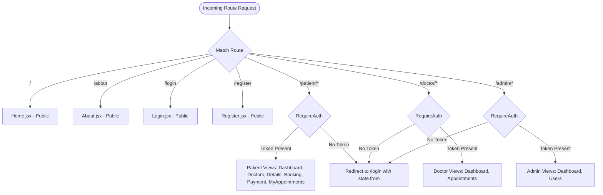
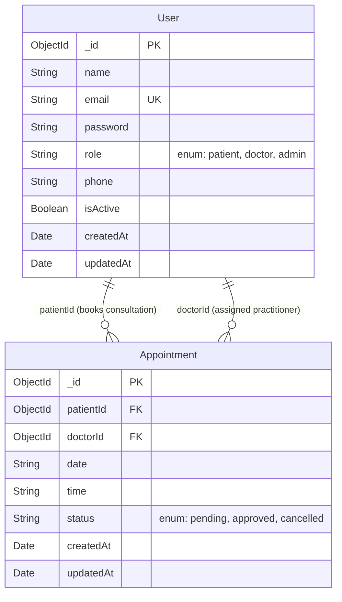
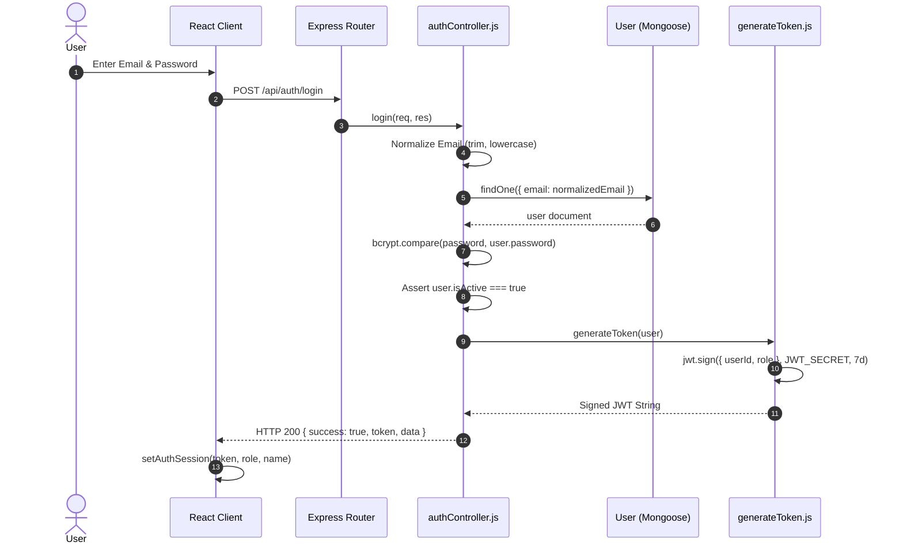
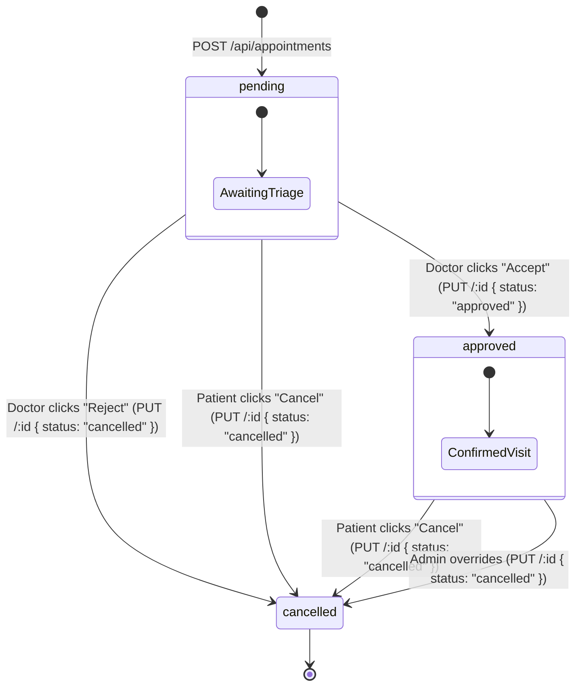
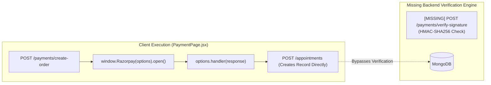
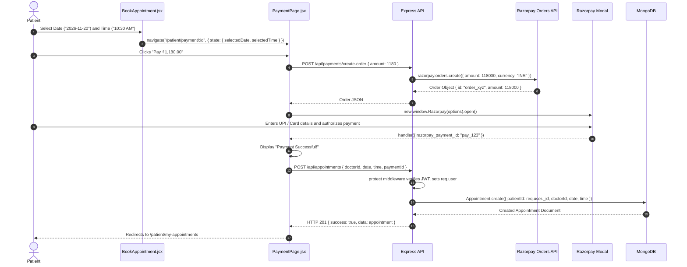

# MediConnect - Low-Level Design (LLD)

---

## 1. Document Information

| Attribute | Specification |
| :--- | :--- |
| **Project Name** | MediConnect |
| **Document Title** | Low-Level Design (LLD) Document |
| **Document Version** | 1.0.0 |
| **Document Status** | Approved / Initial Technical Documentation |
| **Date of Preparation** | November 4, 2026 |
| **System Category** | Outpatient Doctor Consultation & Appointment Scheduling System |
| **Repository URL** | [https://github.com/dkhemka12/MediConnect](https://github.com/dkhemka12/MediConnect) |
| **Live Web App** | [https://medi-connect-henna.vercel.app/](https://medi-connect-henna.vercel.app/) |
| **Target Audience** | Software Engineers, Code Reviewers, Systems Maintainers, Technical Evaluators |

### Document Revision History

| Version | Date | Author / Role | Summary of Changes |
| :--- | :--- | :--- | :--- |
| `1.0.0` | 2026-11-04 | Senior Software Engineer & Technical Documentation Architect | Complete baseline Low-Level Design derived from exhaustive source code inspection across client and server directories. |

---

## Table of Contents

- [1. Document Information](#1-document-information)
- [2. Introduction](#2-introduction)
  - [2.1 Purpose of the Low-Level Design](#21-purpose-of-the-low-level-design)
  - [2.2 Relationship to PRD and HLD](#22-relationship-to-prd-and-hld)
  - [2.3 Codebase Grounding & Authority Statement](#23-codebase-grounding--authority-statement)
- [3. Detailed Project Structure](#3-detailed-project-structure)
  - [3.1 Repository Directory Tree](#31-repository-directory-tree)
  - [3.2 Directory & File Responsibility Matrix](#32-directory--file-responsibility-matrix)
- [4. Frontend Detailed Design](#4-frontend-detailed-design)
  - [4.1 Application Initialization Pipeline](#41-application-initialization-pipeline)
  - [4.2 Client Routing Architecture](#42-client-routing-architecture)
  - [4.3 Shared UI Components](#43-shared-ui-components)
  - [4.4 Page Controllers & Views](#44-page-controllers--views)
  - [4.5 Frontend API Service Layer](#45-frontend-api-service-layer)
- [5. Backend Detailed Design](#5-backend-detailed-design)
  - [5.1 Application Entry Point (`server.js`)](#51-application-entry-point-serverjs)
  - [5.2 Database Connection Manager (`config/db.js`)](#52-database-connection-manager-configdbjs)
  - [5.3 Authentication & Authorization Middleware (`middleware/authMiddleware.js`)](#53-authentication--authorization-middleware-middlewareauthmiddlewarejs)
  - [5.4 Cryptographic Utilities (`utils/generateToken.js`)](#54-cryptographic-utilities-utilsgeneratetokenjs)
- [6. Database Design and Schemas](#6-database-design-and-schemas)
  - [6.1 Mongoose Schemas & Data Dictionary](#61-mongoose-schemas--data-dictionary)
  - [6.2 Entity-Relationship & Population Model](#62-entity-relationship--population-model)
- [7. Controller-Level Design](#7-controller-level-design)
  - [7.1 Authentication Controller (`authController.js`)](#71-authentication-controller-authcontrollerjs)
  - [7.2 User Management Controller (`userController.js`)](#72-user-management-controller-usercontrollerjs)
  - [7.3 Appointment Management Controller (`appointmentController.js`)](#73-appointment-management-controller-appointmentcontrollerjs)
  - [7.4 Payment Controller (`paymentController.js`)](#74-payment-controller-paymentcontrollerjs)
- [8. Complete API Reference](#8-complete-api-reference)
- [9. Authentication Implementation Details](#9-authentication-implementation-details)
- [10. Appointment Lifecycle & State Machine](#10-appointment-lifecycle--state-machine)
- [11. Razorpay Integration Details](#11-razorpay-integration-details)
- [12. Environment Variables](#12-environment-variables)
- [13. Error Handling Architecture](#13-error-handling-architecture)
- [14. Frontend and Backend Integration Workflows](#14-frontend-and-backend-integration-workflows)
- [15. Testing Considerations & Verification Checklist](#15-testing-considerations--verification-checklist)
- [16. Technical Limitations & Improvement Areas](#16-technical-limitations--improvement-areas)
- [17. Maintenance and Extension Guidelines](#17-maintenance-and-extension-guidelines)
- [18. Glossary & Technical Terminology](#18-glossary--technical-terminology)

---

## 2. Introduction

### 2.1 Purpose of the Low-Level Design
This Low-Level Design (LLD) document serves as the granular, implementation-level specification of the **MediConnect** outpatient consultation system. While the High-Level Design (HLD) outlines the macro-architectural topology and tiers, this document provides the code-level blueprints: exact function signatures, variable scopes, parameter contracts, execution steps, database query structures, error propagation sequences, and UI state bindings.

### 2.2 Relationship to PRD and HLD
```
┌────────────────────────────────────────────────────────┐
│ Product Requirements Document (PRD.md)                 │
│ "What" the business and users need (Requirements)      │
└──────────────────────────┬─────────────────────────────┘
                           │
                           ▼
┌────────────────────────────────────────────────────────┐
│ High-Level Design (HLD.md)                             │
│ "How" systems communicate at the macro level (Tiers)    │
└──────────────────────────┬─────────────────────────────┘
                           │
                           ▼
┌────────────────────────────────────────────────────────┐
│ Low-Level Design (LLD.md)                              │
│ "How" each file, function, schema, and API operates     │
└────────────────────────────────────────────────────────┘
```

### 2.3 Codebase Grounding & Authority Statement
This document is derived directly from an exhaustive audit of every source file in the repository. It avoids speculative abstractions, unreferenced frameworks, or hypothetical microservices. Every schema field, route path, controller function, and status normalization documented herein corresponds to actual code running in `client/` and `server/`.

---

## 3. Detailed Project Structure

### 3.1 Repository Directory Tree

```
MediConnect/
├── package.json                       # Root script orchestrator (concurrently)
├── package-lock.json                  # Root dependency lockfile
├── README.md                          # Repository documentation
├── PRD.md                             # Product Requirements Document
├── HLD.md                             # High-Level Design Document
├── LLD.md                             # Low-Level Design Document (This File)
├── .gitignore                         # Root Git exclusion rules
├── client/                            # Frontend Single Page Application (React + Vite)
│   ├── package.json                   # Client dependencies (React 19, React Router 7)
│   ├── package-lock.json              # Client dependency lockfile
│   ├── vite.config.js                 # Vite bundler & dev server config (port 5173)
│   ├── vercel.json                    # Vercel deployment rewrite rules for SPA
│   ├── eslint.config.js               # ESLint linting configuration
│   ├── index.html                     # HTML5 entry point & Razorpay SDK script tag
│   ├── .env.example                   # Client environment variable template
│   ├── public/                        # Static assets (logo.png, favicon.svg, virus.png)
│   └── src/                           # Client source root
│       ├── main.jsx                   # React DOM root bootstrapping & StrictMode
│       ├── App.jsx                    # Route dispatcher & layout boundary
│       ├── index.css                  # Global styles, variables, typography
│       ├── components/                # Shared layout & reusable UI widgets
│       │   ├── Navbar.jsx             # Responsive navigation bar with role switching
│       │   ├── Navbar.css             # Navigation styles
│       │   ├── Footer.jsx             # Site footer with static links
│       │   ├── Footer.css             # Footer styles
│       │   ├── DoctorCard.jsx         # Practitioner card with fallback avatar
│       │   ├── DoctorCard.css         # Doctor card styles
│       │   └── RequireAuth.jsx        # Route protection wrapper component
│       ├── pages/                     # Routed page controllers
│       │   ├── Home.jsx               # Public landing page with hero CTA
│       │   ├── Home.css               # Landing page styles
│       │   ├── auth/                  # Authentication views
│       │   │   ├── Login.jsx          # User login form
│       │   │   ├── Login.css          # Auth styling (Login & Register)
│       │   │   └── Register.jsx       # Account registration form (Patient/Doctor)
│       │   ├── patient/               # Patient portal pages
│       │   │   ├── Dashboard.jsx      # Patient metrics & recent visits
│       │   │   ├── Dashboard.css      # Patient dashboard styles
│       │   │   ├── Doctors.jsx        # Searchable, filterable doctor directory
│       │   │   ├── Doctors.css        # Doctor directory styles
│       │   │   ├── DoctorDetails.jsx  # Detailed doctor profile & slot preview
│       │   │   ├── DoctorDetails.css  # Doctor details styles
│       │   │   ├── BookAppointment.jsx# Date and time selector form
│       │   │   ├── BookAppointment.css# Booking form styles
│       │   │   ├── PaymentPage.jsx    # Checkout summary & Razorpay modal trigger
│       │   │   ├── PaymentPage.css    # Payment view styles
│       │   │   ├── MyAppointments.jsx # Filterable appointment history & cancellation
│       │   │   ├── MyAppointments.css # Appointment list styles
│       │   │   ├── About.jsx          # Informational platform mission page
│       │   │   └── About.css          # About page styles
│       │   ├── doctor/                # Doctor clinical portal pages
│       │   │   ├── Dashboard.jsx      # Daily agenda, patient metrics & quick actions
│       │   │   ├── Dashboard.css      # Doctor dashboard styles
│       │   │   ├── Appointments.jsx   # Clinical queue with Accept/Reject actions
│       │   │   └── Appointments.css   # Doctor appointment table styles
│       │   └── admin/                 # Governance portal pages
│       │       ├── Dashboard.jsx      # Platform analytics overview (Mock data)
│       │       ├── Dashboard.css      # Admin dashboard styles
│       │       ├── Users.jsx          # User directory with activation toggles
│       │       └── Users.css          # User management styles
│       └── services/                  # Data access & API abstraction layer
│           ├── api.js                 # HTTP fetch client with Bearer token injection
│           ├── auth.js                # LocalStorage session manager
│           ├── authService.js         # API wrappers for /api/auth
│           ├── appointmentService.js  # API wrappers for /api/appointments
│           └── userService.js         # API wrappers for /api/users
└── server/                            # Backend REST API Application (Node + Express)
    ├── package.json                   # Server dependencies (Express 5, Mongoose 9, Razorpay)
    ├── package-lock.json              # Server dependency lockfile
    ├── server.js                      # Express server entry point, CORS & route mounts
    ├── .env.example                   # Server environment variable template
    ├── config/
    │   └── db.js                      # MongoDB connection manager via Mongoose
    ├── middleware/
    │   └── authMiddleware.js          # protect (JWT verification) & requireRole (RBAC)
    ├── models/
    │   ├── User.js                    # User collection schema & default activation logic
    │   └── Appointment.js             # Appointment collection schema & status enums
    ├── controllers/
    │   ├── authController.js          # User registration, bcrypt hashing & login
    │   ├── userController.js          # Doctor discovery, user directory & activation
    │   ├── appointmentController.js   # Booking, scoped queries & status normalization
    │   └── paymentController.js       # Razorpay order generation
    ├── routes/
    │   ├── authRoutes.js              # Express router for /api/auth
    │   ├── userRoutes.js              # Express router for /api/users
    │   ├── appointmentRoutes.js       # Express router for /api/appointments
    │   └── paymentRoutes.js           # Express router for /api/payments
    └── utils/
        └── generateToken.js           # JWT signing utility using HS256
```

---

### 3.2 Directory & File Responsibility Matrix

| File / Directory | Module Layer | Runtime Scope | Primary Technical Responsibility |
| :--- | :--- | :--- | :--- |
| `client/src/main.jsx` | Presentation Entry | Client | Initializes React root, wraps application in `React.StrictMode` and `BrowserRouter`, loads global CSS. |
| `client/src/App.jsx` | Presentation Routing | Client | Declares all top-level routes, attaches layout shells (`Navbar`, `Footer`), applies `RequireAuth` guards. |
| `client/src/components/RequireAuth.jsx` | Presentation Security | Client | Route wrapper checking `isAuthenticated()`; navigates to `/login` with redirect state if unauthenticated. |
| `client/src/services/api.js` | Transport Layer | Client | Centralized fetch wrapper adding `Authorization: Bearer <token>` and handling JSON serialization/deserialization. |
| `client/src/services/auth.js` | Session State | Client | Reads, writes, and clears `token`, `role`, and `name` keys in browser `localStorage`. |
| `server/server.js` | Application Gateway | Server | Express 5 application setup, CORS origin whitelisting, body parsers, route mounting, and health check endpoint. |
| `server/config/db.js` | Persistence Adapter | Server | Connects Mongoose to MongoDB Atlas/local cluster with crash-fast `process.exit(1)` on error. |
| `server/middleware/authMiddleware.js`| Security Interceptor | Server | Extracts and validates Bearer JWT tokens, validates active status (`isActive`), attaches `req.user`, enforces RBAC. |
| `server/models/User.js` | Domain Data Model | Server | Mongoose schema enforcing unique emails, password validation, role enum, and dynamic doctor inactive defaults. |
| `server/models/Appointment.js` | Domain Data Model | Server | Mongoose schema maintaining relational references (`patientId`, `doctorId`), date/time, and status enums. |
| `server/controllers/` | Business Logic | Server | Orchestrates application logic, input validation, database querying, status normalization, and HTTP responses. |
| `server/utils/generateToken.js` | Cryptography Helper | Server | Signs JWT tokens containing `userId` and `role` claims with HMAC-SHA256 (`HS256`). |

---

## 4. Frontend Detailed Design

### 4.1 Application Initialization Pipeline

```
index.html ──> loads checkout.js ──> main.jsx ──> StrictMode ──> BrowserRouter ──> App.jsx
```

1. **HTML Entry (`client/index.html`):**
   - Sets viewport and metadata.
   - Loads the Razorpay hosted checkout script: `<script src="https://checkout.razorpay.com/v1/checkout.js"></script>`.
   - Mounts `<div id="root"></div>`.
2. **React Root (`client/src/main.jsx`):**
   - Invokes `ReactDOM.createRoot(document.getElementById("root"))`.
   - Wraps root in `<React.StrictMode>` for development warning assertions.
   - Mounts `<BrowserRouter>` from `react-router-dom` to initialize HTML5 History API routing.
   - Imports `client/src/index.css` defining CSS variables (`--primary: #2b5c46`, `--text-main: #2c332a`, etc.).

---

### 4.2 Client Routing Architecture

The routing table in `client/src/App.jsx` defines 15 distinct routes categorized by access protection:



#### Detailed Client Route Mapping Table:

| Route Path | Component Mounted | Access Level | Description |
| :--- | :--- | :--- | :--- |
| `/` | `<Home />` | Public | Public landing page with introductory CTA buttons. |
| `/about` | `<About />` | Public | Public informational page detailing platform highlights. |
| `/login` | `<Login />` | Public | Form for email/password authentication. |
| `/register` | `<Register />` | Public | Form for patient/doctor account creation. |
| `/patient/dashboard` | `<Dashboard />` | Protected (`RequireAuth`) | Patient overview, statistics cards, and recent visits. |
| `/patient/doctors` | `<Doctors />` | Protected (`RequireAuth`) | Searchable and filterable active doctor directory. |
| `/patient/about` | `<About />` | Protected (`RequireAuth`) | Authenticated view of the about page. |
| `/patient/doctor/:id` | `<DoctorDetails />` | Protected (`RequireAuth`) | Detailed profile view for a specific doctor. |
| `/patient/book-appointment/:id`| `<BookAppointment />` | Protected (`RequireAuth`) | Date and time selector for appointment booking. |
| `/patient/payment/:id` | `<PaymentPage />` | Protected (`RequireAuth`) | Consultation fee summary and Razorpay modal trigger. |
| `/patient/my-appointments` | `<MyAppointments />` | Protected (`RequireAuth`) | Filterable history of patient bookings with cancellation. |
| `/doctor/dashboard` | `<DoctorDashboard />` | Protected (`RequireAuth`) | Doctor daily schedule, patient count, and pending requests. |
| `/doctor/appointments` | `<DoctorAppointments />` | Protected (`RequireAuth`) | Clinical queue with Accept (`approved`) and Reject (`cancelled`) actions. |
| `/admin/dashboard` | `<AdminDashboard />` | Protected (`RequireAuth`) | Operational metrics snapshot (mock data). |
| `/admin/users` | `<AdminUsers />` | Protected (`RequireAuth`) | User directory with one-click activation/deactivation toggles. |

> [!WARNING]
> **Client-Side Authorization Observation:**
> `RequireAuth.jsx` solely verifies `isAuthenticated()` (presence of a token string in `localStorage`). It does **not** evaluate `getUserRole()`. Consequently, a logged-in patient could enter `/admin/dashboard` in the browser address bar and load the component shell. However, the backend REST API enforces strict role authorization via `requireRole("admin")`, returning HTTP 403 on all unauthorized data requests.

---

### 4.3 Shared UI Components

#### 1. `Navbar.jsx`
- **Location:** `client/src/components/Navbar.jsx`
- **Purpose:** Primary application navigation header.
- **Props:** None.
- **Internal State:** None (derives status synchronously via `isAuthenticated()` and `getUserRole()`).
- **Dynamic Routing Mapping:**
  ```javascript
  const DASHBOARD_ROUTES = {
    patient: "/patient/dashboard",
    doctor: "/doctor/dashboard",
    admin: "/admin/dashboard",
  };
  ```
- **Behavior:**
  - If authenticated: Renders "Dashboard" link pointing to `DASHBOARD_ROUTES[role]` and a "Logout" button. Clicking Logout invokes `clearAuthSession()` and navigates to `/`.
  - If unauthenticated: Renders "Home", "Doctors", "About", "Login", and "Get Started" (`/register`).

#### 2. `DoctorCard.jsx`
- **Location:** `client/src/components/DoctorCard.jsx`
- **Purpose:** Renders an individual practitioner summary card in the directory grid.
- **Props:**
  - `doctor` (Object, required): `{ id, name, specialty, experience, rating, reviews, location, availability, image }`.
  - `onViewProfile` (Function, required): Callback invoked when "View Profile" is clicked.
  - `onBookNow` (Function, required): Callback invoked when "Book Now" is clicked.
- **Fallback Logic:** If `doctor.image` is undefined, derives initials:
  ```javascript
  const initials = doctor.name.split(" ").map((w) => w[0]).join("").slice(0, 2);
  ```
- **Hardcoded Consultation Fee:** Displays flat fee `"₹1000"`.

#### 3. `RequireAuth.jsx`
- **Location:** `client/src/components/RequireAuth.jsx`
- **Purpose:** Higher-Order Route Guard for React Router v7.
- **Props:** `children` (ReactNode).
- **Execution:**
  ```javascript
  const location = useLocation();
  if (!isAuthenticated()) {
    return <Navigate to="/login" replace state={{ from: location.pathname }} />;
  }
  return children;
  ```

---

### 4.4 Page Controllers & Views

#### 1. Authentication Pages (`Login.jsx`, `Register.jsx`)
- **`Login.jsx`:**
  - State: `email`, `password`, `errorMessage`, `isSubmitting`.
  - Reads `location.state?.message` for flash notices (e.g., pending doctor approval).
  - On submit: Calls `loginUser({ email, password })`. Calls `setAuthSession({ token, role, name })`.
  - Redirection: Checks `location.state?.from`; if missing, redirects to `ROLE_ROUTES[role]`.
- **`Register.jsx`:**
  - State: `role` (select: `"patient"` or `"doctor"`), `name`, `email`, `password`, `errorMessage`, `isSubmitting`.
  - On submit: Calls `registerUser({ name, email, password, role })`.
  - Post-Registration Branching:
    - If `role === "patient"`: Immediately receives `token` and `isActive: true`; auto-logs in and routes to `/patient/dashboard`.
    - If `role === "doctor"`: Receives `isActive: false` (no token); routes to `/login` with `state: { message: "Doctor account created. An admin must activate it before login." }`.

#### 2. Patient Views (`Doctors.jsx`, `DoctorDetails.jsx`, `BookAppointment.jsx`, `PaymentPage.jsx`, `MyAppointments.jsx`, `Dashboard.jsx`)
- **`Doctors.jsx`:**
  - Fetches doctors using `fetchDoctors()` (`GET /api/users/doctors`).
  - Maps records to include UI fallbacks (`specialty || "General Physician"`, `rating || "4.7"`, `fees || "₹120"`).
  - Search & Filter: Synchronous client-side filtering on `searchQuery` (name/specialty) and `selectedSpecialty` radio buttons.
- **`DoctorDetails.jsx`:**
  - Fetches all doctors via `fetchDoctors()`, matches doctor by `useParams().id`.
  - Displays bio, education, quick stats, and next available slots (`slots || ["10:00 AM", "11:00 AM", "12:00 PM"]`).
  - CTA "Book Appointment" navigates to `/patient/book-appointment/:id`.
- **`BookAppointment.jsx`:**
  - State: `selectedDate`, `selectedTime`, `errorMessage`.
  - Renders `<input type="date">` and `<input type="time">`.
  - On submit: Validates input presence; dispatches `navigate("/patient/payment/:id", { state: { selectedDate, selectedTime } })`.
- **`PaymentPage.jsx`:**
  - Extracts `selectedDate` and `selectedTime` from `location.state`. If absent, redirects back to booking.
  - Hardcoded Billing: `mockFee = 1000.0`, `mockTax = 180.0`, `total = 1180.0`.
  - Payment Flow: Calls `POST /api/payments/create-order` with `{ amount: 1180 }`. Initializes `new window.Razorpay(options)`. In the `handler` callback, calls `createAppointment({ doctorId, date, time, paymentId })`. Navigates to `/patient/my-appointments` after a 2-second timeout.
- **`MyAppointments.jsx`:**
  - Fetches appointments via `getMyAppointments()`.
  - Renders status statistics cards: Total, Upcoming (`confirmed` or `pending`), Completed, Cancelled.
  - Tab Filter: `all`, `confirmed`, `pending`, `completed`, `cancelled`.
  - Cancellation Action: Displays "Cancel Appointment" button for `confirmed` or `pending` items. Invokes `cancelAppointment(id)`, which issues `PUT /api/appointments/:id` with `{ status: "cancelled" }`.
- **`patient/Dashboard.jsx`:**
  - Executes parallel queries: `Promise.all([fetchDoctors(), getMyAppointments()])`.
  - Aggregates visit counts and renders up to 3 recent bookings.

#### 3. Doctor Views (`Dashboard.jsx`, `Appointments.jsx`)
- **`doctor/Dashboard.jsx`:**
  - Fetches appointments via `getMyAppointments()`.
  - Filters appointments matching `new Date().toISOString().slice(0, 10)` for "Today's Appointments".
  - Calculates unique patients using `new Set(list.map(i => i.patientName)).size`.
  - Contains placeholder quick actions ("Update Availability", "View Patients", "Messages").
- **`doctor/Appointments.jsx`:**
  - Fetches doctor's assigned bookings.
  - If status is `"pending"`, renders binary decision buttons:
    - **Accept:** Calls `updateAppointmentStatus(id, "approved")`.
    - **Reject:** Calls `updateAppointmentStatus(id, "cancelled")`.

#### 4. Admin Views (`Dashboard.jsx`, `Users.jsx`)
- **`admin/Dashboard.jsx`:**
  - Renders static hardcoded analytics: "Total Doctors: 24", "Total Patients: 186", "Total Revenue: ₹12,450", "Pending Requests: 8".
- **`admin/Users.jsx`:**
  - Fetches all platform users via `fetchUsers()` (`GET /api/users`).
  - Displays user cards with role, email, and active status badge.
  - Action Toggle: Invokes `setUserActivation(user.id, !user.isActive)` (`PUT /api/users/:id/activation`). Dynamically updates state to reflect "Active" / "Inactive".

---

### 4.5 Frontend API Service Layer

The frontend API architecture avoids third-party HTTP libraries (such as Axios), relying on a native `fetch` abstraction:

#### 1. Core Fetch Client (`client/src/services/api.js`)
```javascript
const API_BASE_URL = import.meta.env.VITE_API_BASE_URL || "http://localhost:5000/api";

const buildHeaders = (customHeaders = {}) => {
  const token = getAuthToken();
  return {
    "Content-Type": "application/json",
    ...(token ? { Authorization: `Bearer ${token}` } : {}),
    ...customHeaders,
  };
};

export const requestJson = async (path, options = {}) => {
  const response = await fetch(`${API_BASE_URL}${path}`, {
    ...options,
    headers: buildHeaders(options.headers),
  });

  const data = await response.json().catch(() => null);

  if (!response.ok) {
    const message = data?.message || `Request failed with status ${response.status}`;
    throw new Error(message);
  }

  return data;
};
```

#### 2. Session Store (`client/src/services/auth.js`)
- `getAuthToken()`: `localStorage.getItem("token")`
- `getUserRole()`: `localStorage.getItem("role")`
- `getUserName()`: `localStorage.getItem("name")`
- `isAuthenticated()`: `Boolean(getAuthToken())`
- `setAuthSession({ token, role, name })`: Writes keys to `localStorage`.
- `clearAuthSession()`: Removes keys from `localStorage`.

#### 3. Domain API Modules
- **`authService.js`:**
  - `loginUser({ email, password })`: `POST /auth/login`
  - `registerUser({ name, email, password, role })`: `POST /auth/register`
- **`userService.js`:**
  - `fetchDoctors()`: `GET /users/doctors` (returns `response.data`)
  - `fetchUsers()`: `GET /users` (returns `response.data`)
  - `setUserActivation(userId, isActive)`: `PUT /users/${userId}/activation` with `{ isActive }`
- **`appointmentService.js`:**
  - `getMyAppointments()`: `GET /appointments`, maps each item via `normalizeAppointment`.
  - `createAppointment(payload)`: `POST /appointments` with `{ doctorId, date, time, paymentId }`.
  - `updateAppointmentStatus(id, status)`: `PUT /appointments/${id}` with `{ status }`.
  - `cancelAppointment(id)`: Invokes `updateAppointmentStatus(id, "cancelled")`.

---

## 5. Backend Detailed Design

### 5.1 Application Entry Point (`server.js`)
- **Initialization:** Invokes `dotenv.config()`. Resolves `PORT = process.env.PORT || 5000` and `CLIENT_ORIGIN = process.env.CLIENT_URL || "http://localhost:5173"`.
- **Middleware Chain:**
  1. `cors({ origin: CLIENT_ORIGIN })`: Enforces CORS header injection.
  2. `express.json()`: Parses incoming JSON request bodies.
- **Route Dispatcher Mounting:**
  - `app.use("/api/auth", authRoutes);`
  - `app.use("/api/users", userRoutes);`
  - `app.use("/api/payments", require("./routes/paymentRoutes"));`
  - `app.use("/api/appointments", appointmentRoutes);`
- **Health Check Endpoint:**
  ```javascript
  app.get("/api/health", (req, res) => {
    res.status(200).json({ success: true, message: "Server is running" });
  });
  ```
- **Server Bootstrap (`startServer`):**
  Executes `await connectDB()`, then binds HTTP listener `app.listen(PORT, ...)`.

---

### 5.2 Database Connection Manager (`config/db.js`)
```javascript
const mongoose = require("mongoose");

const connectDB = async () => {
  try {
    await mongoose.connect(process.env.MONGO_URI);
    console.log("MongoDB connected successfully");
  } catch (error) {
    console.error(`MongoDB connection error: ${error.message}`);
    process.exit(1); // Enforces crash-fast failure on invalid database connection
  }
};

module.exports = connectDB;
```

---

### 5.3 Authentication & Authorization Middleware (`middleware/authMiddleware.js`)

#### 1. `protect` Middleware Function
- **Purpose:** Verifies Bearer JWT, fetches user record, checks active status, and populates `req.user`.
- **Signature:** `(req, res, next) => Promise<void>`
- **Execution Algorithm:**
  1. Reads `req.headers.authorization`. Checks for `"Bearer <token>"`. If missing, returns HTTP 401 (`"Not authorized"`).
  2. Executes `jwt.verify(token, process.env.JWT_SECRET)`.
  3. Queries MongoDB: `await User.findById(decoded.userId).select("-password")`. If null, returns HTTP 401 (`"Not authorized"`).
  4. Asserts account activation: `if (!user.isActive)` returns HTTP 403 (`"Account is inactive. Please contact the admin."`).
  5. Assigns `req.user = user` and calls `next()`.
  6. On any catch error (e.g., token expired, signature tampered), returns HTTP 401 (`"Not authorized"`).

#### 2. `requireRole` Middleware Higher-Order Function
- **Purpose:** Restricts endpoint access to specific roles.
- **Signature:** `(...roles) => (req, res, next) => void`
- **Execution Algorithm:**
  1. Inspects `req.user.role`.
  2. Checks `if (!roles.includes(req.user.role))` returns HTTP 403 (`"Not authorized"`).
  3. If role matches, invokes `next()`.

---

### 5.4 Cryptographic Utilities (`utils/generateToken.js`)
- **Signature:** `generateToken(user) => string`
- **Payload Structure:**
  ```javascript
  {
    userId: user._id,
    role: user.role
  }
  ```
- **Signing Parameters:** Secret `process.env.JWT_SECRET`, algorithm `HS256`, expiration options `{ expiresIn: process.env.JWT_EXPIRES_IN || "7d" }`.

---

## 6. Database Design and Schemas

### 6.1 Mongoose Schemas & Data Dictionary

#### 1. `User` Schema (`server/models/User.js`)

| Field Name | BSON Type | Constraints & Rules | Default Value | Technical Purpose |
| :--- | :--- | :--- | :--- | :--- |
| `_id` | ObjectId | Auto-generated Primary Key | `new ObjectId()` | Unique identity identifier |
| `name` | String | `required: [true, "Name is required"]`, `trim: true` | None | User's full name |
| `email` | String | `required: [true, "Email is required"]`, `unique: true`, `lowercase: true`, `trim: true` | None | Unique login credential & lookup key |
| `password` | String | `required: [true, "Password is required"]`, `minlength: 6` | None | 60-character bcrypt hash string |
| `role` | String | `enum: ["patient", "doctor", "admin"]` | `"patient"` | RBAC authority determinant |
| `phone` | String | Optional | `""` | Contact telephone number |
| `isActive` | Boolean | Computed via dynamic default function | Dynamic function | Gatekeeper flag (`doctor` $\rightarrow$ `false`; `patient`/`admin` $\rightarrow$ `true`) |
| `createdAt` | Date | Timestamp auto-managed | System Time | Record creation timestamp |
| `updatedAt` | Date | Timestamp auto-managed | System Time | Record modification timestamp |

```javascript
// Dynamic Default Activation in User.js
isActive: {
  type: Boolean,
  default: function () {
    return this.role === "doctor" ? false : true;
  },
}
```

#### 2. `Appointment` Schema (`server/models/Appointment.js`)

| Field Name | BSON Type | Constraints & Rules | Default Value | Technical Purpose |
| :--- | :--- | :--- | :--- | :--- |
| `_id` | ObjectId | Auto-generated Primary Key | `new ObjectId()` | Unique appointment identifier |
| `patientId` | ObjectId | `required: [true, "Patient ID is required"]`, `ref: "User"` | None | Foreign key reference to booking Patient |
| `doctorId` | ObjectId | `required: [true, "Doctor ID is required"]`, `ref: "User"` | None | Foreign key reference to assigned Doctor |
| `date` | String | `required: [true, "Appointment date is required"]` | None | ISO date string (`YYYY-MM-DD`) |
| `time` | String | `required: [true, "Appointment time is required"]` | None | Consultation time slot string |
| `status` | String | `enum: ["pending", "approved", "cancelled"]` | `"pending"` | Lifecycle state machine status |
| `createdAt` | Date | Timestamp auto-managed | System Time | Record creation timestamp |
| `updatedAt` | Date | Timestamp auto-managed | System Time | Record modification timestamp |

---

### 6.2 Entity-Relationship & Population Model



#### Referential Population Implementation:
In `appointmentController.js` (`getAppointments`), appointments populate referenced user data while projecting away password hashes:
```javascript
const appointments = await Appointment.find(query)
  .populate("patientId", "name email phone")
  .populate("doctorId", "name email phone")
  .sort({ createdAt: -1 });
```

---

## 7. Controller-Level Design

### 7.1 Authentication Controller (`authController.js`)

#### 1. `register(req, res)`
- **Route & Method:** `POST /api/auth/register`
- **Access Level:** Public
- **Input Parameters:** `req.body`: `{ name, email, password, role, phone }`
- **Execution Algorithm:**
  1. Normalizes email: `String(email || "").trim().toLowerCase()`.
  2. Validation: If `!name || !normalizedEmail || !password`, returns HTTP 400 (`"Name, email, and password are required"`).
  3. Collision Check: `User.findOne({ email: normalizedEmail })`. If exists, returns HTTP 409 (`"User already exists with this email"`).
  4. Hashing: `await bcrypt.hash(password, 10)`.
  5. Activation Evaluation: `isActive = (role === "doctor" ? false : true)`.
  6. Database Insert: `User.create({ name, email: normalizedEmail, password: hashedPassword, role, phone, isActive })`.
  7. Token Generation: If `user.isActive === true`, attaches `token = generateToken(user)`.
  8. Response: Returns HTTP 201 with `{ success: true, message, data, token? }`.

#### 2. `login(req, res)`
- **Route & Method:** `POST /api/auth/login`
- **Access Level:** Public
- **Input Parameters:** `req.body`: `{ email, password }`
- **Execution Algorithm:**
  1. Normalizes email: `String(email || "").trim().toLowerCase()`.
  2. Validation: If `!normalizedEmail || !password`, returns HTTP 400 (`"Email and password are required"`).
  3. User Lookup: `User.findOne({ email: normalizedEmail })`. If null, returns HTTP 401 (`"Invalid email or password"`).
  4. Password Comparison: `await bcrypt.compare(password, user.password)`. If false, returns HTTP 401 (`"Invalid email or password"`).
  5. Active Gate: If `!user.isActive`, returns HTTP 403 (`"Account is inactive. Please wait for admin approval."`).
  6. Token Generation: `token = generateToken(user)`.
  7. Response: Returns HTTP 200 with `{ success: true, message: "Login successful", token, data }`.

---

### 7.2 User Management Controller (`userController.js`)

#### 1. `getDoctors(req, res)`
- **Route & Method:** `GET /api/users/doctors`
- **Access Level:** Public
- **Execution Steps:**
  1. Queries: `User.find({ role: "doctor", isActive: true }).select("-password").sort({ createdAt: -1 })`.
  2. Returns HTTP 200 with `{ success: true, count: doctors.length, data: doctors }`.

#### 2. `getUsers(req, res)`
- **Route & Method:** `GET /api/users`
- **Access Level:** Private (`protect`, `requireRole("admin")`)
- **Execution Steps:**
  1. Queries: `User.find().select("-password").sort({ createdAt: -1 })`.
  2. Returns HTTP 200 with `{ success: true, count: users.length, data: users }`.

#### 3. `setUserActivation(req, res)`
- **Route & Method:** `PUT /api/users/:id/activation`
- **Access Level:** Private (`protect`, `requireRole("admin")`)
- **Input Parameters:** `req.params.id`, `req.body.isActive` (boolean).
- **Execution Steps:**
  1. Validation: `if (typeof isActive !== "boolean")` returns HTTP 400 (`"isActive must be true or false"`).
  2. Database Update: `User.findByIdAndUpdate(id, { isActive }, { new: true, runValidators: true }).select("-password")`.
  3. If user null, returns HTTP 404 (`"User not found"`).
  4. Returns HTTP 200 with `{ success: true, message: "User activated/deactivated successfully", data: user }`.

---

### 7.3 Appointment Management Controller (`appointmentController.js`)

#### Helper: `normalizeStatus(status)`
```javascript
const normalizeStatus = (status) => {
  const value = String(status || "").toLowerCase();
  if (["approved", "confirmed"].includes(value)) return "approved";
  if (value === "cancelled" || value === "canceled") return "cancelled";
  if (value === "pending") return "pending";
  return null;
};
```

#### 1. `bookAppointment(req, res)`
- **Route & Method:** `POST /api/appointments`
- **Access Level:** Private (`protect`)
- **Input Parameters:** `req.body`: `{ doctorId, date, time }`
- **Execution Steps:**
  1. Validation: If `!doctorId || !date || !time`, returns HTTP 400 (`"Doctor ID, date, and time are required"`).
  2. Database Insert:
     ```javascript
     const appointment = await Appointment.create({
       patientId: req.user._id, // Enforced from authenticated token
       doctorId,
       date,
       time,
     });
     ```
  3. Returns HTTP 201 with `{ success: true, message: "Appointment booked successfully", data: appointment }`.

#### 2. `getAppointments(req, res)`
- **Route & Method:** `GET /api/appointments`
- **Access Level:** Private (`protect`)
- **Execution Steps:**
  1. Builds query based on role:
     ```javascript
     let query = {};
     if (req.user.role === "patient") query.patientId = req.user._id;
     else if (req.user.role === "doctor") query.doctorId = req.user._id;
     ```
  2. Executes: `Appointment.find(query).populate("patientId", "name email phone").populate("doctorId", "name email phone").sort({ createdAt: -1 })`.
  3. Returns HTTP 200 with `{ success: true, count: appointments.length, data: appointments }`.

#### 3. `updateAppointmentStatus(req, res)`
- **Route & Method:** `PUT /api/appointments/:id`
- **Access Level:** Private (`protect` + Record Ownership Guard)
- **Input Parameters:** `req.params.id`, `req.body.status`
- **Execution Steps:**
  1. `normalizedStatus = normalizeStatus(status)`. If null, returns HTTP 400 (`"Valid status is required"`).
  2. `appointment = await Appointment.findById(id)`. If null, returns HTTP 404 (`"Appointment not found"`).
  3. Ownership Evaluation:
     - If `req.user.role === "doctor"` and `appointment.doctorId != req.user._id`, returns HTTP 403.
     - If `req.user.role === "patient"` and `appointment.patientId != req.user._id`, returns HTTP 403.
  4. Role Transition Rules:
     - If Doctor and `normalizedStatus` not in `["approved", "cancelled"]`, returns HTTP 400.
     - If Patient and `normalizedStatus !== "cancelled"`, returns HTTP 400.
  5. Mutates `appointment.status = normalizedStatus` and executes `await appointment.save()`.
  6. Returns HTTP 200 with `{ success: true, message: "Appointment status updated...", data: appointment }`.

---

### 7.4 Payment Controller (`paymentController.js`)

#### 1. `createOrder(req, res)`
- **Route & Method:** `POST /api/payments/create-order`
- **Access Level:** Public *(Unauthenticated in current codebase)*
- **Input Parameters:** `req.body.amount` (Number, e.g., `1180`)
- **SDK Setup:**
  ```javascript
  const Razorpay = require("razorpay");
  const razorpay = new Razorpay({
    key_id: process.env.RAZORPAY_KEY_ID,
    key_secret: process.env.RAZORPAY_KEY_SECRET,
  });
  ```
- **Execution Steps:**
  1. Reads `amount` from `req.body`.
  2. Calls Razorpay Orders API:
     ```javascript
     const order = await razorpay.orders.create({
       amount: amount * 100, // Converts INR to paise
       currency: "INR",
       receipt: `receipt_${Date.now()}`,
     });
     ```
  3. Returns JSON `order` object.
  4. Catch Error: Returns HTTP 500 (`{ error: "Order creation failed" }`).

---

## 8. Complete API Reference

### 8.1 API Contract Summary Table

| HTTP Verb | Path | Auth Required | Role Allowed | Request Body Schema | Expected Success Response | HTTP Status Codes |
| :--- | :--- | :---: | :---: | :--- | :--- | :--- |
| `POST` | `/api/auth/register` | No | Public | `{ name, email, password, role, phone? }` | `{ success: true, message, data, token? }` | 201, 400, 409, 500 |
| `POST` | `/api/auth/login` | No | Public | `{ email, password }` | `{ success: true, message, token, data }` | 200, 400, 401, 403, 500 |
| `GET` | `/api/users/doctors` | No | Public | None | `{ success: true, count, data: [doctor] }` | 200, 500 |
| `GET` | `/api/users` | Yes | `admin` | None | `{ success: true, count, data: [user] }` | 200, 401, 403, 500 |
| `PUT` | `/api/users/:id/activation` | Yes | `admin` | `{ isActive: boolean }` | `{ success: true, message, data: user }` | 200, 400, 401, 403, 404, 500 |
| `POST` | `/api/appointments` | Yes | All (`patient`) | `{ doctorId, date, time }` | `{ success: true, message, data: appointment }` | 201, 400, 401, 403, 500 |
| `GET` | `/api/appointments` | Yes | All | None | `{ success: true, count, data: [appointment] }` | 200, 401, 403, 500 |
| `PUT` | `/api/appointments/:id` | Yes | All (Scoped) | `{ status }` | `{ success: true, message, data: appointment }` | 200, 400, 401, 403, 404, 500 |
| `POST` | `/api/payments/create-order` | No | Public | `{ amount }` | `{ id, amount, currency, receipt, ... }` | 200, 500 |
| `GET` | `/api/health` | No | Public | None | `{ success: true, message: "Server is running" }` | 200 |

---

### 8.2 Detailed Endpoint Specifications & JSON Payloads

#### 1. `POST /api/auth/register`
- **Headers:** `Content-Type: application/json`
- **Request JSON Example:**
  ```json
  {
    "name": "Dr. Sunita Patel",
    "email": "sunita.patel@clinic.org",
    "password": "Password123!",
    "role": "doctor",
    "phone": "9876543210"
  }
  ```
- **Success Response (Doctor, HTTP 201):**
  ```json
  {
    "success": true,
    "message": "Doctor account created. Waiting for admin activation.",
    "data": {
      "id": "6724a1b2c3d4e5f678901234",
      "name": "Dr. Sunita Patel",
      "email": "sunita.patel@clinic.org",
      "role": "doctor",
      "phone": "9876543210",
      "isActive": false
    }
  }
  ```
- **Success Response (Patient, HTTP 201):**
  ```json
  {
    "success": true,
    "message": "User registered successfully",
    "token": "eyJhbGciOiJIUzI1NiIsInR5cCI6IkpXVCJ9...",
    "data": {
      "id": "6724a1b2c3d4e5f678901235",
      "name": "Rahul Verma",
      "email": "rahul.verma@example.com",
      "role": "patient",
      "phone": "9876543211",
      "isActive": true
    }
  }
  ```
- **Error Response (HTTP 409 Conflict):**
  ```json
  {
    "success": false,
    "message": "User already exists with this email"
  }
  ```

#### 2. `POST /api/auth/login`
- **Request JSON Example:**
  ```json
  {
    "email": "sunita.patel@clinic.org",
    "password": "Password123!"
  }
  ```
- **Success Response (HTTP 200):**
  ```json
  {
    "success": true,
    "message": "Login successful",
    "token": "eyJhbGciOiJIUzI1NiIsInR5cCI6IkpXVCJ9...",
    "data": {
      "id": "6724a1b2c3d4e5f678901234",
      "name": "Dr. Sunita Patel",
      "email": "sunita.patel@clinic.org",
      "role": "doctor",
      "phone": "9876543210",
      "isActive": true
    }
  }
  ```
- **Error Response (Inactive Account, HTTP 403):**
  ```json
  {
    "success": false,
    "message": "Account is inactive. Please wait for admin approval."
  }
  ```

#### 3. `GET /api/appointments`
- **Headers:** `Authorization: Bearer <token>`
- **Success Response (HTTP 200):**
  ```json
  {
    "success": true,
    "message": "Appointments fetched successfully",
    "count": 1,
    "data": [
      {
        "_id": "6724b987c3d4e5f678905678",
        "patientId": {
          "_id": "6724a1b2c3d4e5f678901235",
          "name": "Rahul Verma",
          "email": "rahul.verma@example.com",
          "phone": "9876543211"
        },
        "doctorId": {
          "_id": "6724a1b2c3d4e5f678901234",
          "name": "Dr. Sunita Patel",
          "email": "sunita.patel@clinic.org",
          "phone": "9876543210"
        },
        "date": "2026-11-20",
        "time": "11:00 AM",
        "status": "pending",
        "createdAt": "2026-11-04T10:00:00.000Z",
        "updatedAt": "2026-11-04T10:00:00.000Z"
      }
    ]
  }
  ```

---

## 9. Authentication Implementation Details



### Technical Steps:
1. **Password Hashing:** `bcrypt.hash(password, 10)` generates a 60-character string containing algorithm version, cost factor, salt (22 characters), and hash (31 characters).
2. **Stateless Session Tokens:** `jwt.sign()` generates a header/payload/signature trio. Tokens are verified using `jwt.verify(token, process.env.JWT_SECRET)`.
3. **Session Invalidation:** Tokens expire after `7d`. In the current codebase, immediate server-side revocation is not supported; however, setting `isActive = false` in MongoDB instantly blocks the user across all endpoints via the `protect` middleware.

---

## 10. Appointment Lifecycle & State Machine



### Implementation Facts Regarding Availability & Duplicate Prevention:
- **No Double-Booking Prevention:** `bookAppointment` in `appointmentController.js` does **not** check whether an appointment already exists for `{ doctorId, date, time }`.
- **No Real-Time Calendar Locks:** Time slots are not dynamically linked to doctor calendar availability; the slot array in `DoctorDetails.jsx` is hardcoded.

---

## 11. Razorpay Integration Details

### 11.1 SDK Initialization & Architecture
In `server/controllers/paymentController.js`:
```javascript
const Razorpay = require("razorpay");

const razorpay = new Razorpay({
  key_id: process.env.RAZORPAY_KEY_ID,
  key_secret: process.env.RAZORPAY_KEY_SECRET,
});
```

### 11.2 Order Generation Parameters
- `amount`: `amount * 100` (e.g., `1180 * 100 = 118000` paise).
- `currency`: `"INR"`.
- `receipt`: `` `receipt_${Date.now()}` ``.

### 11.3 Missing Cryptographic Signature Verification


> [!CAUTION]
> **Architectural Risk:** The backend lacks a cryptographic verification endpoint (`crypto.createHmac("sha256", secret).update(order_id + "|" + payment_id).digest("hex") === signature`). An attacker can invoke `POST /api/appointments` directly without completing Razorpay checkout.

---

## 12. Environment Variables

### 12.1 Backend Environment Variables (`server/.env.example`)

| Variable Name | Required | Default / Placeholder | Technical Purpose |
| :--- | :---: | :--- | :--- |
| `PORT` | Optional | `5000` | Port on which the Express HTTP server listens. |
| `MONGO_URI` | **Required** | `your_mongodb_connection_string` | MongoDB connection URI string including credentials and replica set parameters. |
| `JWT_SECRET` | **Required** | `your_strong_jwt_secret` | Symmetric secret key used for HMAC-SHA256 signing of JWT tokens. |
| `JWT_EXPIRES_IN` | Optional | `7d` | Token validity timeframe string passed to `jsonwebtoken`. |
| `CLIENT_URL` | **Required** | `http://localhost:5173` | Allowed origin header value passed into Express `cors()` middleware. |
| `RAZORPAY_KEY_ID` | **Required** | `your_razorpay_key_id` | Razorpay public key ID used for server-side order creation. |
| `RAZORPAY_KEY_SECRET` | **Required** | `your_razorpay_key_secret` | Razorpay private secret key used for server-side order creation. |

### 12.2 Frontend Environment Variables (`client/.env.example`)

| Variable Name | Required | Default / Placeholder | Technical Purpose |
| :--- | :---: | :--- | :--- |
| `VITE_API_BASE_URL` | **Required** | `http://localhost:5000/api` | Base URL used by `api.js` to dispatch REST HTTP requests. |
| `VITE_RAZORPAY_KEY_ID` | **Required** | `your_razorpay_key_id` | Razorpay client key ID injected into `window.Razorpay` options. |

---

## 13. Error Handling Architecture

The backend utilizes structured error propagation across all controllers:

| Status Code | Scenario / Condition | Controller Location | Response Format |
| :---: | :--- | :--- | :--- |
| **200** | Successful resource fetch or status mutation | All Controllers | `{ success: true, message?, data?, count? }` |
| **201** | Successful creation of User or Appointment | `authController`, `appointmentController` | `{ success: true, message, data, token? }` |
| **400** | Missing required parameters, invalid status, or invalid isActive | `authController`, `appointmentController`, `userController` | `{ success: false, message: "Validation error..." }` |
| **401** | Missing/invalid JWT, or invalid login credentials | `authController`, `authMiddleware` | `{ success: false, message: "Not authorized" / "Invalid..." }` |
| **403** | Inactive account, forbidden role, or appointment ownership mismatch | `authController`, `authMiddleware`, `appointmentController` | `{ success: false, message: "Account is inactive..." / "Not authorized..." }` |
| **404** | Target User or Appointment record not found | `userController`, `appointmentController` | `{ success: false, message: "User/Appointment not found" }` |
| **409** | Email already registered in system | `authController.register` | `{ success: false, message: "User already exists with this email" }` |
| **500** | Database exception or unhandled server error | All Controllers | `{ success: false, message: error.message }` |

---

## 14. Frontend and Backend Integration Workflows

### 14.1 Complete Appointment Booking & Payment Sequence



---

## 15. Testing Considerations & Verification Checklist

> [!NOTE]
> *Inspection Reality Check:* Automated unit or integration test suites (e.g., Jest, Mocha, Cypress) are **not present** in the repository (root `package.json` test script contains `"echo \"Error: no test specified\" && exit 1"`). The checklist below outlines the recommended test verification suite for developers maintaining the platform:

| Test Identifier | Category | Test Case Scenario | Expected Result |
| :--- | :--- | :--- | :--- |
| **TC-AUTH-01** | Unit (Auth) | Register with missing email or password | HTTP 400 Bad Request with descriptive message. |
| **TC-AUTH-02** | Unit (Auth) | Register with duplicate email | HTTP 409 Conflict (`"User already exists..."`). |
| **TC-AUTH-03** | Integration | Register doctor account | Doctor record created with `isActive === false`; no token returned. |
| **TC-AUTH-04** | Integration | Inactive doctor attempts login | HTTP 403 Forbidden (`"Account is inactive..."`). |
| **TC-AUTH-05** | Security | Access `/api/users` without token | HTTP 401 Unauthorized (`"Not authorized"`). |
| **TC-AUTH-06** | Security | Patient token attempts access to `/api/users` | HTTP 403 Forbidden (`"Not authorized"`). |
| **TC-ADMIN-01**| Functional | Admin executes `PUT /api/users/:id/activation` | Updates `isActive` flag in DB; returns updated user object. |
| **TC-APT-01** | Functional | Patient queries `GET /api/appointments` | Returns only appointments where `patientId === req.user._id`. |
| **TC-APT-02** | Functional | Doctor queries `GET /api/appointments` | Returns only appointments where `doctorId === req.user._id`. |
| **TC-APT-03** | Security | Patient attempts to update status to `"approved"` | HTTP 400 Bad Request (`"Patients can only cancel appointments"`). |
| **TC-APT-04** | Security | Doctor attempts to update another doctor's booking | HTTP 403 Forbidden (`"Not authorized to update this appointment"`). |
| **TC-PAY-01** | Integration | `POST /api/payments/create-order` with amount `1000` | Returns Razorpay order with `amount: 100000` paise and `currency: "INR"`. |

---

## 16. Technical Limitations & Improvement Areas

| # | Discovered Technical Limitation | Code Location | Architectural Impact | Remediation Strategy |
| :---: | :--- | :--- | :--- | :--- |
| **1** | **Missing Server-Side Slot Collision Lock** | `appointmentController.js` | Multiple patients can concurrently book the exact same `doctorId`, `date`, and `time`. | Add compound unique index `{ doctorId: 1, date: 1, time: 1, status: { $ne: "cancelled" } }`. |
| **2** | **Missing Cryptographic Payment Verification** | `paymentController.js` | Direct calls to `POST /api/appointments` bypass payment settlement. | Implement `POST /api/payments/verify-signature` using HMAC-SHA256 signature checking. |
| **3** | **Unprotected Payment Order Creation** | `paymentRoutes.js` | Anyone can flood the server with Razorpay order generation requests. | Attach `protect` middleware to `paymentRoutes.js`. |
| **4** | **Unchecked Client Route Guard** | `RequireAuth.jsx` | Non-admin users can view the admin dashboard UI structure. | Extend `RequireAuth` to evaluate `allowedRoles` prop against `getUserRole()`. |
| **5** | **XSS Exposure in LocalStorage** | `services/auth.js` | JWT tokens stored in `localStorage` can be stolen via XSS scripts. | Migrate JWT storage to `httpOnly`, `Secure`, `SameSite=Strict` cookies. |
| **6** | **Schema-to-Presentation Discrepancy** | `models/User.js` vs `Doctors.jsx` | Doctor specialty, rating, reviews, and fees are hardcoded client fallbacks. | Extend Mongoose `User` schema or introduce a `DoctorProfile` collection. |
| **7** | **Static Admin Dashboard Analytics** | `admin/Dashboard.jsx` | Metric cards display static mock arrays rather than live database metrics. | Implement an aggregate endpoint `GET /api/admin/metrics` using MongoDB pipelines. |
| **8** | **Lack of Database Pagination** | `getUsers`, `getAppointments` | Returning full collections causes memory spikes under high data volume. | Introduce cursor or page/limit query parameters (`skip`, `limit`). |

---

## 17. Maintenance and Extension Guidelines

For developers extending the MediConnect platform, follow these modular conventions:

### 1. Adding a New API Endpoint
1. Define controller logic in `server/controllers/<domain>Controller.js`.
2. Register the route path and HTTP verb in `server/routes/<domain>Routes.js`.
3. Apply `protect` and `requireRole(...)` middleware in the route definition if authentication is required.
4. Mount the route module in `server/server.js` if introducing a new resource namespace.

### 2. Adding a New Mongoose Schema
1. Create `server/models/<ModelName>.js`.
2. Define fields with explicit validation rules, enums, defaults, and timestamps.
3. Export the compiled model: `module.exports = mongoose.model("<ModelName>", schema);`.

### 3. Adding a New Frontend Page
1. Create the page component and CSS module in `client/src/pages/<domain>/<PageName>.jsx`.
2. Import the component in `client/src/App.jsx`.
3. Declare the `<Route path="..." element={...} />`. Wrap in `<RequireAuth>` if access requires authentication.
4. Add API consumer functions inside `client/src/services/<domain>Service.js`.

---

## 18. Glossary & Technical Terminology

- **Bcrypt:** Adaptive hash function incorporating an exponential work factor and random salt generation to prevent rainbow-table and dictionary attacks.
- **BSON:** Binary-encoded serialization format used by MongoDB to store documents and represent data structures.
- **CORS:** Cross-Origin Resource Sharing mechanism allowing controlled resource requests from outside origins.
- **HMAC:** Keyed-hash Message Authentication Code used for cryptographic token and payment signature integrity validation.
- **JWT:** JSON Web Token standard (RFC 7519) for transmitting verifiable claims between distributed systems.
- **Mongoose:** Object Data Modeling (ODM) library providing strongly-typed schema models, hooks, and query builders over MongoDB.
- **Paise:** Monetary fractional unit of Indian Rupee (1 INR = 100 paise), required by Razorpay API specifications.
- **RBAC:** Role-Based Access Control mechanism determining system access rights based on assigned user roles.
- **Referential Population:** Mongoose feature that replaces document foreign keys with corresponding populated documents from external collections.
- **SPA:** Single Page Application pattern in React where views dynamically re-render without full browser page reloads.
- **StrictMode:** React development mode tool that highlights potential lifecycle issues and intentional double-renders.
- **Vite:** High-performance frontend build tool utilizing native ES modules and Rollup asset packaging.

