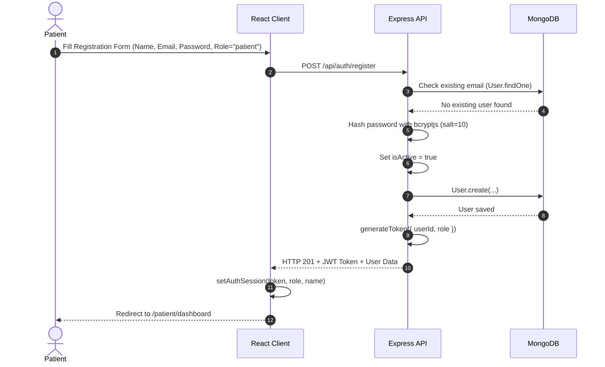
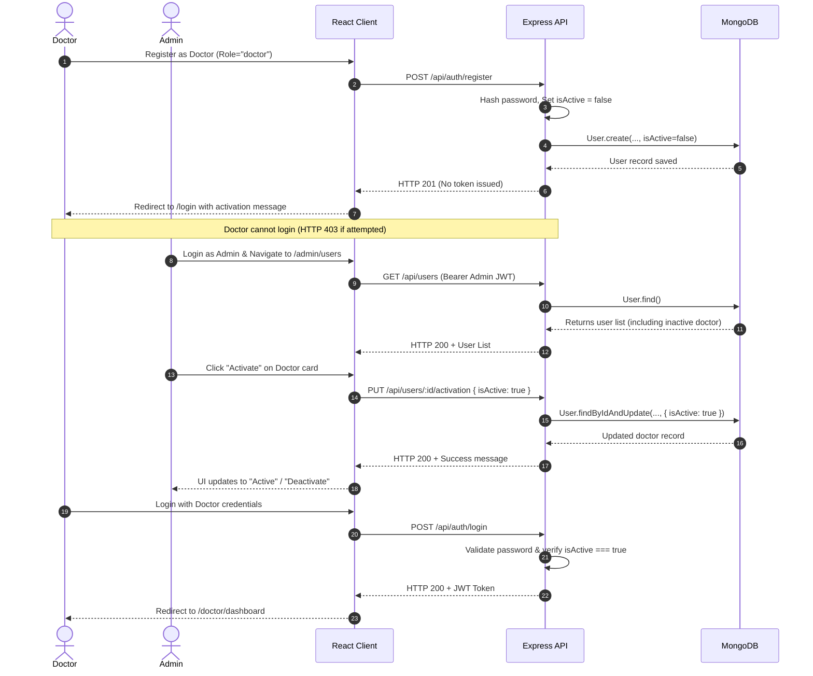
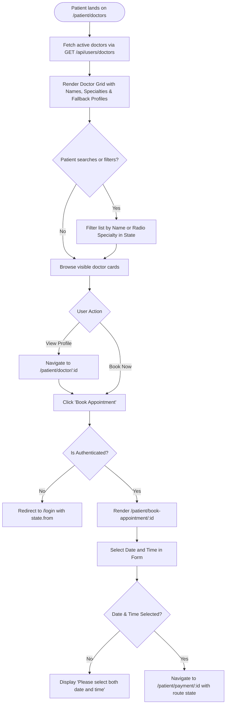
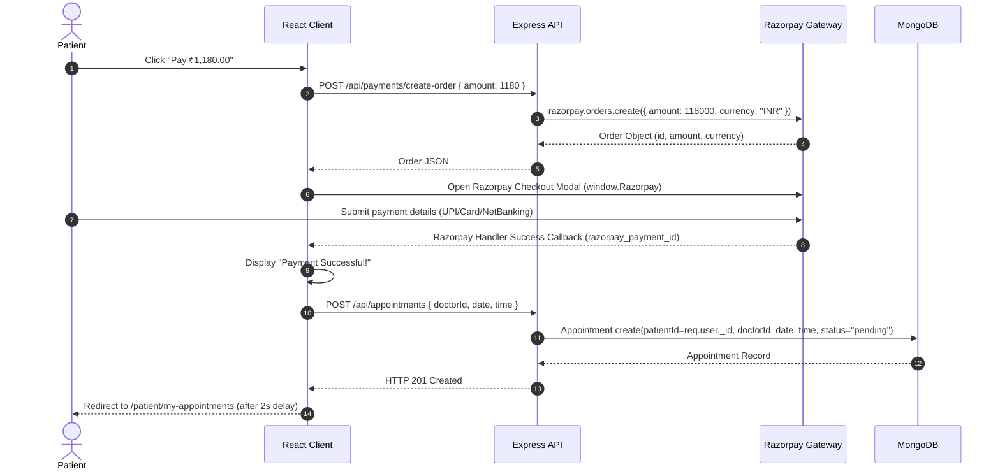
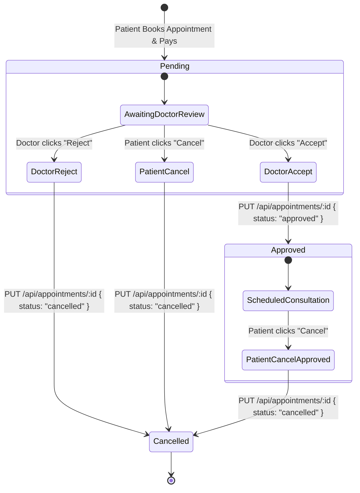
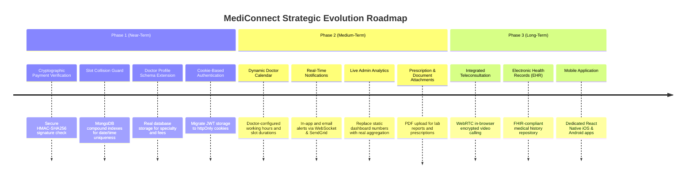

# MediConnect - Product Requirements Document (PRD)

---

## 1. Document Information

| Field | Details |
| :--- | :--- |
| **Project Name** | MediConnect |
| **Document Name** | Product Requirements Document (PRD) |
| **Version** | 1.0.0 |
| **Document Status** | Approved / Initial Project Documentation |
| **Date of Preparation** | November 4, 2026 |
| **Product Category** | Healthcare Technology / Doctor Appointment Management System |
| **Repository URL** | [https://github.com/dkhemka12/MediConnect](https://github.com/dkhemka12/MediConnect) |
| **Live Application** | [https://medi-connect-henna.vercel.app/](https://medi-connect-henna.vercel.app/) |
| **Target Audience** | Academic Evaluators, Engineering Teams, Product Stakeholders, System Administrators |

### Document Revision History

| Version | Date | Author / Role | Summary of Changes |
| :--- | :--- | :--- | :--- |
| `1.0.0` | 2026-11-04 | Lead Product Manager & Technical BA | Full baseline PRD based on deep source code audit across client and server architectures. |

---

## Table of Contents

- [1. Document Information](#1-document-information)
- [2. Executive Summary](#2-executive-summary)
- [3. Problem Statement](#3-problem-statement)
- [4. Product Vision](#4-product-vision)
- [5. Product Objectives](#5-product-objectives)
- [6. Target Users and Personas](#6-target-users-and-personas)
- [7. Functional Requirements](#7-functional-requirements)
  - [7.1 Authentication & Authorization Module (FR-AUTH)](#71-authentication--authorization-module-fr-auth)
  - [7.2 Patient Portal Module (FR-PATIENT)](#72-patient-portal-module-fr-patient)
  - [7.3 Doctor Portal Module (FR-DOCTOR)](#73-doctor-portal-module-fr-doctor)
  - [7.4 Administrator Portal Module (FR-ADMIN)](#74-administrator-portal-module-fr-admin)
  - [7.5 Appointment Lifecycle Module (FR-APPOINTMENT)](#75-appointment-lifecycle-module-fr-appointment)
  - [7.6 Payment Processing Module (FR-PAYMENT)](#76-payment-processing-module-fr-payment)
- [8. Non-Functional Requirements (NFR)](#8-non-functional-requirements-nfr)
- [9. User Journeys and Workflows](#9-user-journeys-and-workflows)
- [10. User Stories and Acceptance Criteria](#10-user-stories-and-acceptance-criteria)
- [11. Product Scope & Boundary Analysis](#11-product-scope--boundary-analysis)
- [12. API Specifications & Technical Interface Contracts](#12-api-specifications--technical-interface-contracts)
- [13. Business Rules & Logic Matrix](#13-business-rules--logic-matrix)
- [14. Risks, Constraints & Technical Debt](#14-risks-constraints--technical-debt)
- [15. Measurable Success Metrics (Proposed KPIs)](#15-measurable-success-metrics-proposed-kpis)
- [16. Product Roadmap](#16-product-roadmap)
- [17. Codebase Implementation Audit & Discrepancy Report](#17-codebase-implementation-audit--discrepancy-report)
- [18. Glossary & Domain Terminology](#18-glossary--domain-terminology)

---

## 2. Executive Summary

**MediConnect** is a centralized, role-based web application engineered to bridge the operational gap between healthcare seekers (patients), medical practitioners (doctors), and clinical governance (administrators). Built upon a modern web architecture—combining a React single-page application (SPA) with a Node.js/Express REST backend and MongoDB data persistence—MediConnect streamlines the patient-doctor consultation journey from discovery and scheduling through digital payments and consultation lifecycle management.

### Core Value Proposition
- **For Patients:** On-demand access to verified, active medical practitioners, frictionless appointment selection, self-service cancellation, and digital payment execution via Razorpay.
- **For Doctors:** Dedicated operational dashboard to oversee consultation schedules, review incoming booking requests, and accept or reject appointments in real time.
- **For Healthcare Administrators:** Centralized governance mechanism to authenticate doctor credentials, review user accounts across the platform, and control practitioner activation status to uphold clinical safety.

---

## 3. Problem Statement

Traditional outpatient booking workflows in clinical and private healthcare practices suffer from operational inefficiencies that degrade patient experience and overburden healthcare staff.

```
+----------------------------------------------------------------------------------------------------+
|                               Traditional Healthcare Scheduling Bottlenecks                        |
+----------------------------------------------------------------------------------------------------+
|  1. Manual Coordination: Reliance on phone calls, front-desk queues, and paper registers.          |
|  2. Opaque Doctor Discovery: Patients struggle to identify specialty, availability, and fees.     |
|  3. Scheduling Friction: Uncoordinated bookings produce double-booking and untracked cancellations.|
|  4. Administrative Strain: Clinic staff spend excessive time validating credentials and schedules. |
|  5. Fragmented Payment Reconciliation: Inconsistent cash or POS collections lead to leakages.     |
+----------------------------------------------------------------------------------------------------+
                                                  │
                                                  ▼
+----------------------------------------------------------------------------------------------------+
|                               MediConnect Solution & Implementation Reality                         |
+----------------------------------------------------------------------------------------------------+
|  * Centralized Doctor Discovery: Directory of admin-verified active medical practitioners.         |
|  * Self-Service Scheduling: Patients select date and time directly in digital portal.              |
|  * Role-Based Access Control (RBAC): Enforces discrete views for Patients, Doctors, and Admins.   |
|  * Admin Gatekeeper Verification: Doctors cannot log in or take bookings until admin approval.     |
|  * Integrated Digital Checkout: Razorpay checkout modal integrated into appointment checkout flow.  |
|  [!] Implementation Note: Dynamic slot conflicts, real-time sync, and backend payment signatures   |
|      are identified as current technical gaps and mapped to subsequent development phases.         |
+----------------------------------------------------------------------------------------------------+
```

### Problem Breakdown & Implementation Alignment
1. **Manual Appointment Coordination:** Traditional outpatient workflows rely heavily on phone calls, front-desk queues, and paper ledgers. *MediConnect addresses this by offering a self-service scheduling interface with instant digital record creation.*
2. **Difficulty Discovering Doctors:** Patients often lack visibility into credentialed doctors, their specialties, and availability. *MediConnect provides a searchable practitioner directory displaying verified, active practitioners.*
3. **Appointment Tracking Challenges:** Patients and doctors lack unified dashboards to monitor upcoming visits, resulting in high no-show rates. *MediConnect provides status-driven portals (`pending`, `approved`, `cancelled`).*
4. **Administrative Workload:** Clinic front desks are overwhelmed with credential verification and appointment rebooking. *MediConnect establishes an admin portal with one-click user activation/deactivation.*
5. **Lack of Centralized Payment Management:** Cash-based or fragmented POS settlements lead to revenue leakage. *MediConnect integrates Razorpay order creation into the appointment booking flow.*

> [!NOTE]
> *Implementation Reality Check:* While MediConnect introduces structural solutions for discovery, scheduling, and role-based workflows, features such as dynamic doctor calendar slot management, automated double-booking prevention, automated SMS/email reminders, and backend cryptographic payment reconciliation represent future roadmap deliverables rather than completed baseline features.

---

## 4. Product Vision

To establish MediConnect as a secure, interoperable, and scalable digital healthcare gateway that unifies outpatient consultation workflows into a frictionless ecosystem. The platform aspires to empower patients with instantaneous access to trusted medical expertise, furnish doctors with intelligent clinical schedule management, and provide healthcare administrators with auditable governance tools.

---

## 5. Product Objectives

1. **Simplify Doctor Discovery:** Provide a filterable directory allowing patients to browse active, verified medical practitioners by name and specialty.
2. **Digitize Appointment Booking:** Enable end-to-end self-service appointment scheduling, eliminating phone and paper-based friction.
3. **Enforce Role-Based Access Control (RBAC):** Deliver tailored, secure portal experiences for Patients, Doctors, and Administrators.
4. **Streamline Doctor Vetting:** Implement an admin approval gatekeeper where doctor accounts remain dormant (`isActive: false`) until authorized by an administrator.
5. **Increase Lifecycle Transparency:** Enable bidirectional appointment state management where doctors can approve/reject (`cancelled`) and patients can cancel pending/approved consultations.
6. **Support Digital Transactions:** Integrate Razorpay gateway checkout to collect consultation fees upfront during booking.

---

## 6. Target Users and Personas

### Persona A: The Healthcare Seeker (Patient)

```
┌────────────────────────────────────────────────────────────────────────┐
│ Persona: Rahul Sharma (Patient)                                       │
│ Age: 32 | Occupation: Corporate Professional | Location: Bengaluru     │
├────────────────────────────────────────────────────────────────────────┤
│ Behaviors & Needs:                                                     │
│ - Searches for credentialed doctors across specialties online.         │
│ - Demands immediate scheduling without phone calls or queue waiting.  │
│ - Expects upfront fee clarity and online payment convenience.          │
│ - Requires tracking and self-cancellation capabilities for bookings.   │
├────────────────────────────────────────────────────────────────────────┤
│ MediConnect Touchpoints:                                               │
│ - Signs up via `/register` (default `isActive: true`, auto-login).     │
│ - Browses `/patient/doctors`, filters by specialty, views profile.     │
│ - Books appointment date/time and pays ₹1,180 via Razorpay modal.      │
│ - Monitors consultation status on `/patient/my-appointments`.          │
└────────────────────────────────────────────────────────────────────────┘
```

### Persona B: The Medical Practitioner (Doctor)

```
┌────────────────────────────────────────────────────────────────────────┐
│ Persona: Dr. Anjali Rao, MD (Doctor)                                  │
│ Age: 44 | Specialty: Cardiologist | Location: Mumbai                   │
├────────────────────────────────────────────────────────────────────────┤
│ Behaviors & Needs:                                                     │
│ - Seeks a digital channel to manage private outpatient consultations.  │
│ - Requires credential vetting prior to accepting clinical bookings.    │
│ - Needs clear daily agenda views to manage clinic workflow.           │
│ - Retains autonomy to accept or reject consultation requests.          │
├────────────────────────────────────────────────────────────────────────┤
│ MediConnect Touchpoints:                                               │
│ - Registers via `/register` with role `doctor` (`isActive: false`).    │
│ - Awaits administrative vetting before login privileges are granted.  │
│ - Logs into `/doctor/dashboard` once activated by administrator.       │
│ - Reviews `/doctor/appointments` and executes "Accept" or "Reject".    │
└────────────────────────────────────────────────────────────────────────┘
```

### Persona C: The Healthcare System Administrator (Admin)

```
┌────────────────────────────────────────────────────────────────────────┐
│ Persona: Vikram Malhotra (System Administrator)                        │
│ Age: 38 | Role: Platform Operations Lead | Location: New Delhi         │
├────────────────────────────────────────────────────────────────────────┤
│ Behaviors & Needs:                                                     │
│ - Governs platform security, authenticity, and user compliance.        │
│ - Inspects user profiles across Patients, Doctors, and Staff.          │
│ - Activates vetted doctor accounts and suspends compromised users.     │
│ - Monitors aggregate platform metrics and system operational health.   │
├────────────────────────────────────────────────────────────────────────┤
│ MediConnect Touchpoints:                                               │
│ - Accesses `/admin/dashboard` to view platform activity snapshot.      │
│ - Manages users via `/admin/users`.                                    │
│ - Toggles practitioner activation state via `/api/users/:id/activation`.│
└────────────────────────────────────────────────────────────────────────┘
```

---

## 7. Functional Requirements

### Requirement Prioritization Framework
- **Must Have (High):** Essential for baseline platform operation and compliance.
- **Should Have (Medium):** Significant operational value; partially implemented or planned.
- **Could Have (Low):** Value-add enhancement slated for future release phases.

### 7.1 Authentication & Authorization Module (FR-AUTH)

| ID | Description | Role | Expected Behaviour | Priority | Current Status |
| :--- | :--- | :--- | :--- | :--- | :--- |
| **FR-AUTH-01** | User Registration | Public | Users can create an account with `name`, `email`, `password`, `role` (`patient`, `doctor`), and optional `phone`. Validates required inputs and lowercase normalized email. | High | **Implemented** |
| **FR-AUTH-02** | Password Hashing | System | Plaintext passwords must be cryptographically hashed using `bcryptjs` with salt round factor 10 prior to persistence in MongoDB. | High | **Implemented** |
| **FR-AUTH-03** | Default Patient Activation | Patient | Accounts registered with role `patient` automatically receive `isActive: true` and immediate JWT session issuance for instant login. | High | **Implemented** |
| **FR-AUTH-04** | Default Doctor Deactivation | Doctor | Accounts registered with role `doctor` receive `isActive: false`. Registration response omits JWT token and instructs user to await admin vetting. | High | **Implemented** |
| **FR-AUTH-05** | Credential Authentication | All | Users submit email and password. Server verifies existence, compares bcrypt hash, checks `isActive` flag, and issues a 7-day signed JWT token upon success. | High | **Implemented** |
| **FR-AUTH-06** | Inactive Account Login Block | Doctor / Patient | Authentication attempts by users where `isActive === false` are rejected with HTTP 403 (`"Account is inactive. Please wait for admin approval."`). | High | **Implemented** |
| **FR-AUTH-07** | JWT Token Generation | System | Token signed with payload containing `userId` (`_id`) and `role`, encrypted with `JWT_SECRET` and expiring per `JWT_EXPIRES_IN` (defaults to `7d`). | High | **Implemented** |
| **FR-AUTH-08** | Client-Side Session Storage | Client | Frontend stores JWT token, role, and user name in browser `localStorage`. Cleared upon explicit logout. | High | **Implemented** |
| **FR-AUTH-09** | Frontend Route Protection | Client | `RequireAuth` component redirects unauthenticated users to `/login`, preserving initial route in navigation state. *(Note: Role-level route restriction on client is not yet enforced).* | Medium | **Partially Implemented** |

### 7.2 Patient Portal Module (FR-PATIENT)

| ID | Description | Role | Expected Behaviour | Priority | Current Status |
| :--- | :--- | :--- | :--- | :--- | :--- |
| **FR-PAT-01** | Patient Dashboard | Patient | Displays personalized welcome header, aggregated statistics (Available Doctors, Upcoming, Completed, Cancelled visits), and up to 3 recent bookings. | High | **Implemented** |
| **FR-PAT-02** | Doctor Discovery Directory | Patient / Public | Lists all active doctors (`isActive: true`). Publicly accessible; displays initials avatar, name, and profile cards. | High | **Implemented** |
| **FR-PAT-03** | Doctor Search & Filtering | Patient | Client-side search by doctor name and specialty; radio-button filtering by available specialties; one-click "Clear Filters" action. | High | **Implemented** |
| **FR-PAT-04** | Doctor Profile Inspection | Patient | Dedicated profile route (`/patient/doctor/:id`) rendering doctor credentials, consultation fee, quick facts, bio, and next slots. | High | **Implemented** |
| **FR-PAT-05** | Appointment Time Selection | Patient | Form at `/patient/book-appointment/:id` allowing input of appointment date and time; enforces selection before routing to payment. | High | **Implemented** |
| **FR-PAT-06** | Patient Appointment History | Patient | Route `/patient/my-appointments` renders categorized appointments with tabbed filters (`all`, `confirmed`, `pending`, `completed`, `cancelled`). | High | **Implemented** |
| **FR-PAT-07** | Patient Appointment Cancellation | Patient | Allows patients to cancel their own `pending` or `confirmed` appointments, triggering a state update to `cancelled`. | High | **Implemented** |
| **FR-PAT-08** | Dynamic Doctor Availability | Patient | Real-time calendar slot availability based on doctor actual working hours and existing booking collision checks. | Medium | **Not Implemented** *(Mocked in UI)* |

### 7.3 Doctor Portal Module (FR-DOCTOR)

| ID | Description | Role | Expected Behaviour | Priority | Current Status |
| :--- | :--- | :--- | :--- | :--- | :--- |
| **FR-DOC-01** | Doctor Dashboard Overview | Doctor | Dedicated dashboard at `/doctor/dashboard` displaying stats: Today's Appointments, Pending Requests, Accepted Patients, Total Unique Patients. | High | **Implemented** |
| **FR-DOC-02** | Today's Clinical Schedule | Doctor | Dashboard displays upcoming appointments matching current system date (`YYYY-MM-DD`). | High | **Implemented** |
| **FR-DOC-03** | Assigned Appointments List | Doctor | Route `/doctor/appointments` retrieves and lists all appointments assigned to the logged-in doctor, showing patient name, date, time, and status. | High | **Implemented** |
| **FR-DOC-04** | Appointment Acceptance | Doctor | For `pending` appointments, doctor can click "Accept", triggering status transition to `approved`. | High | **Implemented** |
| **FR-DOC-05** | Appointment Rejection | Doctor | For `pending` appointments, doctor can click "Reject", triggering status transition to `cancelled`. | High | **Implemented** |
| **FR-DOC-06** | Custom Schedule Management | Doctor | Doctor configuration of available working days, hours, and appointment slot durations. | Medium | **Not Implemented** *(UI placeholder)* |
| **FR-DOC-07** | In-App Patient Messaging | Doctor | Bidirectional communication between doctor and patient regarding appointment details. | Low | **Not Implemented** *(UI placeholder)* |

### 7.4 Administrator Portal Module (FR-ADMIN)

| ID | Description | Role | Expected Behaviour | Priority | Current Status |
| :--- | :--- | :--- | :--- | :--- | :--- |
| **FR-ADM-01** | Admin Dashboard | Admin | Renders executive overview containing platform metrics (Total Doctors, Total Patients, Total Revenue, Pending Requests, Activity Feed). | High | **Partially Implemented** *(Static Demo Data)* |
| **FR-ADM-02** | User Directory Management | Admin | Route `/admin/users` fetches all registered users from `/api/users`, displaying name, email, role, and current active status. | High | **Implemented** |
| **FR-ADM-03** | User Activation Toggle | Admin | Admin can click "Activate" or "Deactivate" for any user, sending `PUT /api/users/:id/activation` with payload `{ isActive: boolean }`. | High | **Implemented** |
| **FR-ADM-04** | Doctor Account Vetting | Admin | Inactive doctor accounts are activated upon admin verification, unlocking doctor login capability and making doctor visible in directory. | High | **Implemented** |
| **FR-ADM-05** | Global Appointment Oversight | Admin | View and update any appointment across the entire platform via backend API. | Medium | **Partially Implemented** *(API supports, UI pending)* |

### 7.5 Appointment Lifecycle Module (FR-APPOINTMENT)

| ID | Description | Role | Expected Behaviour | Priority | Current Status |
| :--- | :--- | :--- | :--- | :--- | :--- |
| **FR-APT-01** | Appointment Booking | Patient | Authenticated patient books appointment with `doctorId`, `date`, `time`. Sets `patientId = req.user._id` and initial status `pending`. | High | **Implemented** |
| **FR-APT-02** | Role-Filtered Listing | All | Endpoint `GET /api/appointments` automatically scopes results: patients see own, doctors see assigned, admins see all. | High | **Implemented** |
| **FR-APT-03** | Population of User Profiles | System | Appointment queries automatically populate `patientId` and `doctorId` with `name`, `email`, and `phone` (passwords excluded). | High | **Implemented** |
| **FR-APT-04** | Status Normalization Engine | System | Backend sanitizes status inputs: `"approved"`/`"confirmed"` -> `"approved"`, `"cancelled"`/`"canceled"` -> `"cancelled"`, `"pending"` -> `"pending"`. | High | **Implemented** |
| **FR-APT-05** | Role-Based Status Authorization | Doctor / Patient | Backend enforces transition rules: Doctors can only set `approved` or `cancelled`; Patients can only set `cancelled`. Unauthorized attempts return HTTP 400. | High | **Implemented** |
| **FR-APT-06** | Appointment Ownership Enforcement | Doctor / Patient | Non-admin users attempting to update appointments that do not belong to them receive HTTP 403 (`"Not authorized to update this appointment"`). | High | **Implemented** |
| **FR-APT-07** | Slot Collision Prevention | System | Rejection of concurrent booking requests for identical doctor, date, and time slots. | High | **Not Implemented** *(Concurrent bookings permitted)* |

### 7.6 Payment Processing Module (FR-PAYMENT)

| ID | Description | Role | Expected Behaviour | Priority | Current Status |
| :--- | :--- | :--- | :--- | :--- | :--- |
| **FR-PAY-01** | Razorpay Order Creation | System | Endpoint `POST /api/payments/create-order` accepts consultation amount, calculates paise (`amount * 100`), generates unique receipt, and returns order. | High | **Implemented** |
| **FR-PAY-02** | Checkout Modal Integration | Patient | Frontend loads Razorpay Checkout SDK (`checkout.js`), presents ₹1,180 total breakdown (₹1,000 fee + ₹180 GST), and opens payment modal. | High | **Implemented** |
| **FR-PAY-03** | Post-Payment Appointment Creation | Patient | Upon client-side Razorpay `handler` callback, frontend triggers `createAppointment` passing booking details and payment reference. | High | **Implemented** |
| **FR-PAY-04** | Cryptographic Signature Verification | Backend | Backend validation of `razorpay_signature` using HMAC SHA256 before confirming appointment creation in database. | High | **Not Implemented** *(Client triggers booking post-payment)* |
| **FR-PAY-05** | Webhook Reconciliation | Backend | Webhook listener (`payment.captured`, `payment.failed`) to reconcile asynchronous payment events. | Medium | **Not Implemented** |

---

## 8. Non-Functional Requirements (NFR)

```
┌────────────────────────────────────────────────────────────────────────┐
│                        NON-FUNCTIONAL REQUIREMENTS MATRIX               │
├────────────────────────────────┬───────────────────────────────────────┤
│ Category                       │ Status Summary                        │
├────────────────────────────────┼───────────────────────────────────────┤
│ NFR-SEC: Security              │ Partially Implemented (JWT, bcrypt)   │
│ NFR-PERF: Performance          │ Implemented (Vite SPA, lean queries)  │
│ NFR-REL: Reliability           │ Partially Implemented (Try/catch)     │
│ NFR-MAINT: Maintainability     │ Implemented (Modular MVC structure)   │
│ NFR-SCALE: Scalability         │ Partially Implemented (Stateless API) │
│ NFR-USAB: Usability            │ Implemented (Intuitive UI, states)    │
│ NFR-RESP: Responsive Design    │ Implemented (Mobile/desktop CSS)      │
│ NFR-DATA: Data Integrity       │ Partially Implemented (Mongoose refs) │
└────────────────────────────────┴───────────────────────────────────────┘
```

### 8.1 Security (NFR-SEC)
- **Password Protection (Verified):** Passwords hashed using `bcryptjs` with 10 salt rounds prior to persistence. Plaintext passwords never stored.
- **Stateless Authorization (Verified):** REST endpoints authenticated via Bearer JWTs verified on each protected request.
- **Account Invalidation Gate (Verified):** Inactive accounts (`isActive: false`) are blocked at login and rejected by `protect` middleware even if possessing a prior token.
- **Identified Gaps (Desired Standards):**
  - JWT tokens stored in `localStorage` are vulnerable to Cross-Site Scripting (XSS). Migration to `httpOnly`, `Secure`, `SameSite` cookies is recommended.
  - Payment order creation endpoint (`POST /api/payments/create-order`) is currently unauthenticated.
  - Lack of rate limiting on `/api/auth/login` and `/api/auth/register` creates exposure to brute-force attacks.

### 8.2 Performance (NFR-PERF)
- **Frontend Bundle & Assets (Verified):** Built using Vite 8 and React 19, enabling sub-second Hot Module Replacement (HMR) and optimized minified production builds.
- **Database Query Latency (Verified):** Indexed lookups on `User.email` (unique index). Field projection (`select("-password")`) reduces network payload.
- **Target Standard:** API response times must remain under 300ms for p95 requests under 100 concurrent users.

### 8.3 Reliability & Availability (NFR-REL)
- **Graceful Error Handling (Verified):** Express controllers implement structured `try/catch` blocks returning standardized JSON `{ success: false, message: error.message }`.
- **System Health Monitoring (Verified):** Endpoint `GET /api/health` returns status 200 `{ success: true, message: "Server is running" }`.
- **Target Standard:** 99.5% uptime during core outpatient booking hours (08:00 - 22:00 IST).

### 8.4 Maintainability (NFR-MAINT)
- **Architectural Modularity (Verified):** Strict separation of concerns following standard MVC pattern:
  - `server/models`: Mongoose schemas and data validation rules.
  - `server/controllers`: Business logic and lifecycle orchestrations.
  - `server/routes`: HTTP verb and endpoint route definitions with middleware chains.
  - `server/middleware`: Interceptor functions (`protect`, `requireRole`).
  - `client/src/services`: Centralized API clients (`api.js`, `authService.js`, `appointmentService.js`, `userService.js`).

### 8.5 Scalability (NFR-SCALE)
- **Stateless Application Tier (Verified):** Express server maintains zero in-memory session state, allowing horizontal replication behind a reverse proxy (e.g., NGINX, AWS ALB).
- **Target Standard:** Separation of read-heavy doctor discovery from write-heavy transactional appointment creation, leveraging MongoDB replica sets for read scaling.

### 8.6 Usability (NFR-USAB)
- **Intuitive Feedback (Verified):** Frontend components render clear loading spinners, empty states ("No doctors matched your search", "No appointments found"), and actionable error banners.
- **Human-Readable Information (Verified):** Date formatters convert ISO strings into standard formats (e.g., "Nov 4, 2026"). Initials avatars provide clean visual fallbacks for doctors.

### 8.7 Responsive Design (NFR-RESP)
- **Multi-Device Compatibility (Verified):** Custom CSS grid and flexbox layouts adapt smoothly from desktop monitors (1440px) down to mobile displays (375px).
- **Mobile Navbar (Verified):** Responsive layout collapses and stacks navigation links for touch accessibility.

### 8.8 Data Integrity (NFR-DATA)
- **Referential Integrity (Verified):** Appointment records maintain strict ObjectId references to `User` collection for `patientId` and `doctorId`.
- **Status Consistency (Verified):** Backend `normalizeStatus` function prevents arbitrary string values from entering database state.
- **Identified Gap (Desired Standard):** MongoDB transactions (`session.withTransaction`) should be introduced to atomically tie booking creation to payment validation.

---

## 9. User Journeys and Workflows

### 9.1 Patient Registration and Login Journey



---

### 9.2 Doctor Registration and Admin Activation Workflow



---

### 9.3 Patient Doctor Discovery & Booking Workflow



---

### 9.4 Payment Initiation & Appointment Finalization Workflow



---

### 9.5 Doctor Appointment Management Workflow



---

## 10. User Stories and Acceptance Criteria

### 10.1 Module: Authentication & Access Control

#### US-AUTH-01: Patient Account Creation
> **As a** prospective patient,  
> **I want to** register an account using my name, email, and password,  
> **so that** I can immediately access healthcare services and schedule appointments.

```gherkin
Scenario: Successful Patient Self-Registration
  Given I am on the "/register" page
  When I select role "Patient", fill in "Name", valid unique "Email", and a valid "Password"
  And I submit the registration form
  Then an account is created in the database with "isActive: true"
  And the backend returns a signed JWT token
  And the browser stores the authentication session in localStorage
  And I am redirected automatically to "/patient/dashboard"

Scenario: Registration with Pre-existing Email
  Given an account already exists with email "patient@example.com"
  When I attempt to register with "patient@example.com"
  Then the server returns an HTTP 409 Conflict error
  And an error message "User already exists with this email" is displayed in the UI
```

#### US-AUTH-02: Doctor Account Registration & Verification Gate
> **As a** medical practitioner,  
> **I want to** register on the platform as a doctor,  
> **so that** I can join the medical directory after administrative vetting.

```gherkin
Scenario: Doctor Registration Requires Admin Activation
  Given I am on the "/register" page
  When I select role "Doctor", enter my credentials, and click "Create account"
  Then my user account is saved with "isActive: false"
  And the API response omits the JWT token
  And I am redirected to "/login" with the message "Doctor account created. An admin must activate it before login."
  When I immediately attempt to log in with my credentials
  Then the server rejects the request with HTTP 403 Forbidden
  And the UI displays "Account is inactive. Please wait for admin approval."
```

---

### 10.2 Module: Patient Portal & Discovery

#### US-PAT-01: Doctor Directory Search & Filtering
> **As a** registered patient,  
> **I want to** search and filter active doctors by name and clinical specialty,  
> **so that** I can find the most relevant healthcare specialist for my condition.

```gherkin
Scenario: Filtering Active Doctors by Specialty
  Given I am logged in and navigate to "/patient/doctors"
  When the page loads, only doctors with "isActive: true" are retrieved from the backend
  When I select the "Cardiologist" specialty filter
  Then only doctors matching "Cardiologist" are displayed in the grid
  When I type "Sharma" into the search bar
  Then only cardiologists whose names contain "Sharma" remain visible
  When I click "Clear Filters"
  Then the search query resets and all active doctors are rendered
```

#### US-PAT-02: Appointment Scheduling & Payment
> **As a** patient,  
> **I want to** choose an appointment date and time and pay the consultation fee,  
> **so that** my consultation request is officially submitted to the doctor.

```gherkin
Scenario: Booking and Checkout Flow
  Given I am on the doctor details page for an active doctor
  When I click "Book Appointment" and select a valid Date and Time
  And I click "Proceed to Payment"
  Then I am navigated to "/patient/payment/:id" showing ₹1,000 fee and ₹180 taxes (Total ₹1,180)
  When I click "Pay ₹1,180.00"
  Then the Razorpay Checkout modal opens with the generated order ID
  When payment succeeds in the Razorpay handler
  Then an appointment request is posted to "/api/appointments"
  And I am redirected to "/patient/my-appointments" showing my appointment in "Pending" status
```

---

### 10.3 Module: Doctor Portal & Appointment Triage

#### US-DOC-01: Reviewing and Deciding on Appointment Requests
> **As an** active doctor,  
> **I want to** view pending consultation requests and choose to accept or reject them,  
> **so that** I can maintain control over my clinical practice schedule.

```gherkin
Scenario: Doctor Accepts an Appointment
  Given I am logged in as an active doctor on "/doctor/appointments"
  When I locate an appointment with status "Pending"
  And I click the "Accept" button
  Then a request is dispatched to "PUT /api/appointments/:id" with payload "{ status: 'approved' }"
  And the appointment status badge updates to "Approved"
  And the decision buttons are hidden

Scenario: Doctor Rejects an Appointment
  Given I am logged in as an active doctor on "/doctor/appointments"
  When I locate an appointment with status "Pending"
  And I click the "Reject" button
  Then a request is dispatched to "PUT /api/appointments/:id" with payload "{ status: 'cancelled' }"
  And the appointment status badge updates to "Cancelled"
```

---

### 10.4 Module: Administrator Governance

#### US-ADM-01: Activating Inactive Doctor Accounts
> **As a** platform administrator,  
> **I want to** inspect registered users and toggle doctor account activation,  
> **so that** only credentialed medical practitioners can access the system and receive bookings.

```gherkin
Scenario: Admin Activates a Newly Registered Doctor
  Given I am logged in as an Administrator on "/admin/users"
  When I locate a doctor user displaying status "Inactive"
  And I click the "Activate" button
  Then an API call "PUT /api/users/:id/activation" is sent with "{ isActive: true }"
  And the user record updates to active in MongoDB
  And the button label dynamically changes to "Deactivate"
  And the doctor is now permitted to log in and appears in public doctor searches
```

---

## 11. Product Scope & Boundary Analysis

```
┌────────────────────────────────────────────────────────────────────────┐
│                        PRODUCT SCOPE TAXONOMY                          │
├────────────────────────────────────────────────────────────────────────┤
│ [IN SCOPE] Implemented in Current Codebase                             │
│  - JWT Authentication, bcrypt password hashing, role persistence       │
│  - Doctor approval workflow (inactive default, admin activation)       │
│  - Public active doctor directory & profile viewing                    │
│  - Appointment creation with patient & doctor population               │
│  - Doctor review workflow (Accept -> approved, Reject -> cancelled)    │
│  - Patient self-service cancellation                                   │
│  - Razorpay order creation & client checkout integration               │
│  - Admin user management table with activation toggle                  │
├────────────────────────────────────────────────────────────────────────┤
│ [OUT OF SCOPE] Explicitly Not Present in Current Codebase              │
│  - Electronic Health Records (EHR) & prescription uploading            │
│  - In-app video/audio teleconsultation engine                          │
│  - Patient medical history & allergy tracking                          │
│  - Multi-hospital / multi-clinic tenancy support                       │
│  - Multi-currency international payment gateways                       │
├────────────────────────────────────────────────────────────────────────┤
│ [FUTURE SCOPE] Planned Improvements on Product Roadmap                 │
│  - Cryptographic backend Razorpay signature verification & webhooks   │
│  - Dynamic doctor schedule calendar & collision prevention             │
│  - Verified doctor reviews, star ratings, and feedback module          │
│  - Automated email/SMS appointment reminders (Twilio/SendGrid)         │
│  - Live admin aggregate analytics dashboard                            │
└────────────────────────────────────────────────────────────────────────┘
```

---

## 12. API Specifications & Technical Interface Contracts

All endpoints are hosted relative to base URL `/api`. Authentication headers must follow the format: `Authorization: Bearer <JWT_TOKEN>`.

### 12.1 Authentication & User Endpoints

#### 1. Register User
- **Method:** `POST`
- **Route:** `/api/auth/register`
- **Access Control:** Public
- **Request Body:**
  ```json
  {
    "name": "Dr. Sarah Jenkins",
    "email": "sarah.jenkins@hospital.org",
    "password": "SecurePassword123!",
    "role": "doctor",
    "phone": "+919876543210"
  }
  ```
- **Response Payload (HTTP 201 - Doctor):**
  ```json
  {
    "success": true,
    "message": "Doctor account created. Waiting for admin activation.",
    "data": {
      "id": "6724a1b2c3d4e5f678901234",
      "name": "Dr. Sarah Jenkins",
      "email": "sarah.jenkins@hospital.org",
      "role": "doctor",
      "phone": "+919876543210",
      "isActive": false
    }
  }
  ```
- **Response Payload (HTTP 201 - Patient):**
  ```json
  {
    "success": true,
    "message": "User registered successfully",
    "token": "eyJhbGciOiJIUzI1NiIsInR5cCI6IkpXVCJ9...",
    "data": {
      "id": "6724a1b2c3d4e5f678901235",
      "name": "Rahul Sharma",
      "email": "rahul.sharma@example.com",
      "role": "patient",
      "phone": "+919876543211",
      "isActive": true
    }
  }
  ```

#### 2. User Login
- **Method:** `POST`
- **Route:** `/api/auth/login`
- **Access Control:** Public
- **Request Body:**
  ```json
  {
    "email": "sarah.jenkins@hospital.org",
    "password": "SecurePassword123!"
  }
  ```
- **Response Payload (HTTP 200 - Success):**
  ```json
  {
    "success": true,
    "message": "Login successful",
    "token": "eyJhbGciOiJIUzI1NiIsInR5cCI6IkpXVCJ9...",
    "data": {
      "id": "6724a1b2c3d4e5f678901234",
      "name": "Dr. Sarah Jenkins",
      "email": "sarah.jenkins@hospital.org",
      "role": "doctor",
      "phone": "+919876543210",
      "isActive": true
    }
  }
  ```
- **Error Response (HTTP 403 - Inactive Doctor):**
  ```json
  {
    "success": false,
    "message": "Account is inactive. Please wait for admin approval."
  }
  ```

#### 3. Fetch Active Doctors Directory
- **Method:** `GET`
- **Route:** `/api/users/doctors`
- **Access Control:** Public
- **Response Payload (HTTP 200):**
  ```json
  {
    "success": true,
    "message": "Doctors fetched successfully",
    "count": 1,
    "data": [
      {
        "_id": "6724a1b2c3d4e5f678901234",
        "name": "Dr. Sarah Jenkins",
        "email": "sarah.jenkins@hospital.org",
        "role": "doctor",
        "phone": "+919876543210",
        "isActive": true,
        "createdAt": "2026-11-04T10:00:00.000Z",
        "updatedAt": "2026-11-04T10:15:00.000Z"
      }
    ]
  }
  ```

#### 4. Fetch All Users (Admin Only)
- **Method:** `GET`
- **Route:** `/api/users`
- **Access Control:** Private (`protect`, `requireRole("admin")`)
- **Response Payload (HTTP 200):**
  ```json
  {
    "success": true,
    "message": "Users fetched successfully",
    "count": 2,
    "data": [
      {
        "_id": "6724a1b2c3d4e5f678901234",
        "name": "Dr. Sarah Jenkins",
        "email": "sarah.jenkins@hospital.org",
        "role": "doctor",
        "phone": "+919876543210",
        "isActive": false,
        "createdAt": "2026-11-04T10:00:00.000Z"
      }
    ]
  }
  ```

#### 5. Update User Activation Status (Admin Only)
- **Method:** `PUT`
- **Route:** `/api/users/:id/activation`
- **Access Control:** Private (`protect`, `requireRole("admin")`)
- **Request Body:**
  ```json
  {
    "isActive": true
  }
  ```
- **Response Payload (HTTP 200):**
  ```json
  {
    "success": true,
    "message": "User activated successfully",
    "data": {
      "_id": "6724a1b2c3d4e5f678901234",
      "name": "Dr. Sarah Jenkins",
      "email": "sarah.jenkins@hospital.org",
      "role": "doctor",
      "phone": "+919876543210",
      "isActive": true
    }
  }
  ```

---

### 12.2 Appointment Endpoints

#### 6. Book an Appointment
- **Method:** `POST`
- **Route:** `/api/appointments`
- **Access Control:** Private (`protect`)
- **Request Body:**
  ```json
  {
    "doctorId": "6724a1b2c3d4e5f678901234",
    "date": "2026-11-15",
    "time": "10:30 AM"
  }
  ```
- **Response Payload (HTTP 201):**
  ```json
  {
    "success": true,
    "message": "Appointment booked successfully",
    "data": {
      "_id": "6724b987c3d4e5f678905678",
      "patientId": "6724a1b2c3d4e5f678901235",
      "doctorId": "6724a1b2c3d4e5f678901234",
      "date": "2026-11-15",
      "time": "10:30 AM",
      "status": "pending",
      "createdAt": "2026-11-04T10:45:00.000Z",
      "updatedAt": "2026-11-04T10:45:00.000Z"
    }
  }
  ```

#### 7. Fetch Scoped Appointments
- **Method:** `GET`
- **Route:** `/api/appointments`
- **Access Control:** Private (`protect`)
- **Behavior:** Dynamically queries `{ patientId: req.user._id }` for patients, `{ doctorId: req.user._id }` for doctors, or `{}` for admins.
- **Response Payload (HTTP 200):**
  ```json
  {
    "success": true,
    "message": "Appointments fetched successfully",
    "count": 1,
    "data": [
      {
        "_id": "6724b987c3d4e5f678905678",
        "patientId": {
          "_id": "6724a1b2c3d4e5f678901235",
          "name": "Rahul Sharma",
          "email": "rahul.sharma@example.com",
          "phone": "+919876543211"
        },
        "doctorId": {
          "_id": "6724a1b2c3d4e5f678901234",
          "name": "Dr. Sarah Jenkins",
          "email": "sarah.jenkins@hospital.org",
          "phone": "+919876543210"
        },
        "date": "2026-11-15",
        "time": "10:30 AM",
        "status": "pending",
        "createdAt": "2026-11-04T10:45:00.000Z"
      }
    ]
  }
  ```

#### 8. Update Appointment Status
- **Method:** `PUT`
- **Route:** `/api/appointments/:id`
- **Access Control:** Private (`protect` + Role Ownership Guard)
- **Request Body:**
  ```json
  {
    "status": "approved"
  }
  ```
- **Response Payload (HTTP 200):**
  ```json
  {
    "success": true,
    "message": "Appointment status updated to approved",
    "data": {
      "_id": "6724b987c3d4e5f678905678",
      "patientId": "6724a1b2c3d4e5f678901235",
      "doctorId": "6724a1b2c3d4e5f678901234",
      "date": "2026-11-15",
      "time": "10:30 AM",
      "status": "approved"
    }
  }
  ```

---

### 12.3 Payment & System Endpoints

#### 9. Create Razorpay Payment Order
- **Method:** `POST`
- **Route:** `/api/payments/create-order`
- **Access Control:** Public *(Identified security enhancement item)*
- **Request Body:**
  ```json
  {
    "amount": 1180
  }
  ```
- **Response Payload (HTTP 200):**
  ```json
  {
    "id": "order_OG9f8k21LmN3pq",
    "entity": "order",
    "amount": 118000,
    "amount_paid": 0,
    "amount_due": 118000,
    "currency": "INR",
    "receipt": "receipt_1730718300000",
    "status": "created",
    "attempts": 0
  }
  ```

#### 10. System Health Check
- **Method:** `GET`
- **Route:** `/api/health`
- **Access Control:** Public
- **Response Payload (HTTP 200):**
  ```json
  {
    "success": true,
    "message": "Server is running"
  }
  ```

---

## 13. Business Rules & Logic Matrix

### BR-01: User Role Hierarchy & Access Boundaries
The platform supports exactly three discrete roles:
- `patient`: Outpatient consumer. Access restricted to personal booking creation, doctor browsing, personal appointment history, and self-cancellation.
- `doctor`: Medical practitioner. Access restricted to assigned patient appointments, schedule agenda, and request acceptance/rejection.
- `admin`: System supervisor. Unrestricted access to user directories, practitioner activation toggles, and global appointment records.

### BR-02: User Registration & Activation Defaults
```
If role == "doctor"  --> isActive = false (Requires Admin activation via PUT /api/users/:id/activation)
If role == "patient" --> isActive = true  (Immediate JWT session creation and access)
If role == "admin"   --> isActive = true
```

### BR-03: Doctor Directory Visibility Policy
Only user records where `role === "doctor"` AND `isActive === true` are returned by the public directory endpoint (`GET /api/users/doctors`). Inactive doctor profiles are excluded to prevent patient bookings with unverified practitioners.

### BR-04: Appointment Ownership & Transition Governance
Appointment status mutations via `PUT /api/appointments/:id` strictly enforce the following state transition matrix:

| Current Status | Target Status | Permitted By | Business Validation Rule |
| :--- | :--- | :--- | :--- |
| `pending` | `approved` | Assigned Doctor, Admin | Doctor confirms clinical availability for the time slot. |
| `pending` | `cancelled` | Assigned Doctor, Booking Patient, Admin | Doctor rejects request OR Patient withdraws request. |
| `approved` | `cancelled` | Booking Patient, Admin | Patient cancels confirmed visit; slot released. |
| `approved` | `completed` | Admin, System *(Planned)* | Clinical consultation concluded. |
| Any Status | Any Status | Administrator | Administrative intervention or dispute resolution. |

Any attempt by a patient to set status to `approved`, or by an unassigned doctor to alter another doctor's consultation, is rejected with HTTP 400 or HTTP 403.

### BR-05: Financial Settlement & Booking Binding
- **Consultation Fee Policy:** Flat fee of ₹1,000.00 + 18% GST (₹180.00), totaling ₹1,180.00 per consultation slot.
- **Transaction Currency:** Indian Rupee (`INR`), converted to integer subunit paise (`118000`) for the payment gateway.
- **Booking Sequence:** Payment order must be initiated and client checkout completed before the frontend invokes `POST /api/appointments`.

---

## 14. Risks, Constraints & Technical Debt

### 14.1 Technical Debt & Code Vulnerabilities

```
+────────────────────────────────────────────────────────────────────────────+
|                     CRITICAL TECHNICAL RISK EVALUATION                     |
+────────────────────────────────────────────────────────────────────────────+
| [HIGH RISK] 1. Unverified Payment Confirmation:                           |
|   Frontend invokes createAppointment() inside Razorpay handler without     |
|   backend cryptographic HMAC-SHA256 signature verification.                |
|   Impact: Malicious actors could bypass payment by calling POST directly.   |
|   Remediation: Implement POST /api/payments/verify-signature endpoint.    |
+────────────────────────────────────────────────────────────────────────────+
| [HIGH RISK] 2. Appointment Slot Concurrency & Double-Booking:              |
|   Appointment creation does not check whether doctorId + date + time       |
|   is already occupied by an approved/pending appointment.                  |
|   Impact: Multiple patients can book the exact same consultation time slot.|
|   Remediation: Add unique compound index { doctorId: 1, date: 1, time: 1 } |
|   and reject overlapping bookings.                                         |
+────────────────────────────────────────────────────────────────────────────+
| [MEDIUM RISK] 3. Client-Side JWT Storage in LocalStorage:                  |
|   Tokens stored in localStorage are vulnerable to XSS exploits.            |
|   Impact: Session hijacking if an XSS script executes on the client.       |
|   Remediation: Store JWT in httpOnly, Secure, SameSite=Strict cookies.     |
+────────────────────────────────────────────────────────────────────────────+
| [MEDIUM RISK] 4. Schema-to-UI Mismatch on Doctor Details:                  |
|   MongoDB User schema lacks fields for specialty, fees, experience, bio.   |
|   Impact: UI falls back to hardcoded mock values for all doctors.          |
|   Remediation: Extend User schema or create DoctorProfile model.           |
+────────────────────────────────────────────────────────────────────────────+
```

### 14.2 Operational & Healthcare Compliance Constraints
- **Data Privacy & Telemedicine Regulations (DISHA / HIPAA):** Healthcare platforms handling patient phone numbers, doctor consultations, and health metadata must adhere to strict data localization and encryption-at-rest mandates.
- **Third-Party Gateway Dependency:** Platform bookings rely on Razorpay API uptime. Downtime or network latency during checkout disrupts the booking journey.
- **Database High Availability:** Current implementation uses a single MongoDB connection URI without documented replica set failovers or database health monitoring.

---

## 15. Measurable Success Metrics (Proposed KPIs)

The following metrics represent proposed Key Performance Indicators for evaluating platform health post-launch:

### 15.1 Acquisition & Growth Metrics
- **Doctor Onboarding Velocity:** Total doctor registrations submitted per month.
- **Doctor Verification Turnaround Time (TAT):** Average elapsed hours from doctor registration to admin activation.
- **Patient Acquisition:** Monthly growth rate of registered patient accounts.

### 15.2 Engagement & Operational Metrics
- **Booking Conversion Rate:** Percentage of doctor profile visits (`/patient/doctor/:id`) that culminate in completed appointments.
- **Appointment Triage Rate:** Percentage of pending appointments accepted or rejected by doctors within 12 hours.
- **Patient Cancellation Rate:** Percentage of total booked appointments cancelled by patients prior to consultation.

### 15.3 Financial & Revenue Metrics
- **Gross Booking Value (GBV):** Cumulative value of consultation fees processed through the platform.
- **Payment Success Rate:** Ratio of successful Razorpay order checkouts against total order creation requests.

---

## 16. Product Roadmap



---

## 17. Codebase Implementation Audit & Discrepancy Report

As part of the technical requirements analysis, the entire repository was subjected to an exhaustive line-by-line code audit. The findings below highlight discrepancies between documentation (e.g., repository `README.md`) and actual source code implementation:

| Inspected Area | Claim in README.md | Actual Implementation in Code | Product Impact & Recommendation |
| :--- | :--- | :--- | :--- |
| **Patient List Endpoint** | Lists `GET /users/patients` | Endpoint **does not exist** in `userRoutes.js` or `userController.js`. | **Low Impact:** Admin inspects all users via `GET /api/users`. README documentation should be updated to remove `/users/patients`. |
| **Payment Verification** | "Payment integration using Razorpay" | `paymentController.js` only implements `createOrder`. No signature verification endpoint exists. Frontend books appointment directly in handler. | **High Risk:** Anyone can POST to `/api/appointments` without paying. A verification endpoint must be prioritized. |
| **Admin Analytics** | "Admin dashboard for user management" | `admin/Dashboard.jsx` displays static, hardcoded numbers (`24 Doctors`, `₹12,450 Revenue`). | **Medium Impact:** Admin user management (`/admin/users`) works completely, but overview dashboard numbers are mock data. |
| **Doctor Profile Fields** | Doctor profiles with specialty and fees | `User.js` model only stores `name`, `email`, `password`, `role`, `phone`, `isActive`. | **Medium Impact:** `Doctors.jsx` uses fallback values (`General Physician`, `₹120`/`₹1000`) for all doctors. |
| **Doctor Schedule Actions** | Doctor dashboard quick actions | Buttons "Update Availability", "View Patients", "Messages" on doctor dashboard have no `onClick` handlers. | **Low Impact:** UI placeholders. Full implementation scheduled for Phase 2 roadmap. |

---

## 18. Glossary & Domain Terminology

- **Admin Activation:** The governance workflow where a platform administrator toggles a doctor's `isActive` flag from `false` to `true`, granting access to the system.
- **bcryptjs:** An optimized JavaScript library used to create cryptographically secure one-way salted hashes of user passwords.
- **Doctor Vetting:** The administrative review of a practitioner's credentials before activating their platform profile.
- **HMAC SHA-256:** Hash-based Message Authentication Code used by payment gateways to cryptographically prove that transaction details were not tampered with.
- **JWT (JSON Web Token):** A compact, URL-safe means of representing claims between two parties, used in MediConnect for stateless bearer authentication.
- **Mongoose:** An Object Data Modeling (ODM) library for MongoDB and Node.js that manages schema validation, relationships, and queries.
- **Paise:** The monetary subunit of the Indian Rupee (1 INR = 100 Paise), required by Razorpay API order parameters.
- **Razorpay Orders API:** An automated server-side integration that registers an intended transaction before opening the frontend checkout modal.
- **RBAC (Role-Based Access Control):** A security architecture that restricts system access based on user role assignments (`patient`, `doctor`, `admin`).
- **Referential Population:** A Mongoose querying mechanism (`populate()`) that automatically replaces referenced ObjectId fields with document data from other collections.
- **SPA (Single-Page Application):** A web application that dynamically rewrites the current web page rather than loading entire new pages from a server.

